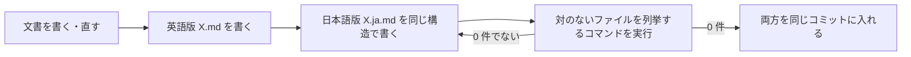

# bilingual-docs — 文書を英語版と日本語版のセットで置く決まり

このリポジトリの文書は、英語版を正とし、日本語版を必ずセットで置く。
読み手に英語で読む人と日本語で読む人の両方がいて、片方にしか無い文書は、もう片方の読み手には無いのと同じため。

文書の書き方そのもの（読む層・文書の長さ・図と文章の使い分け・コードブロックの書き方・冒頭での役割の宣言）は user 側の skill `documenting` が持ち、ここには書かない。この skill は、英語版と日本語版の対をどう保つかだけを扱う。user 側の skill が無い環境では、参照を飛ばしてこの skill だけで進める。



列挙コマンドが 0 件になるまで日本語版を直し、0 件になった英語版と日本語版を同じコミットに入れる。

---

## 対象と対象外

対象は、人が読む Markdown 文書すべて。エージェント向けの指示とその時点の記録は対象外にする。README から案内する Markdown でない見本は対にせず、英語だけで書く。

| 区分 | ファイル | なぜ |
|---|---|---|
| 対象 | `README.md`・`PRD.md`・`CHANGELOG.md`・`docs/` 配下など、`.claude/` と `.github/` の外にある `*.md` | 人が読む文書で、直され続ける |
| 対象外 | `.claude/` と `.github/` 配下（skill・エージェント向けの指示・テンプレート） | 読み手がエージェントで、既存の skill と同じく日本語だけで書く |
| 対象外 | issue と PR の本文 | その時点の記録で、直され続ける文書ではない |
| 対象外 | `LICENSE`、コードのコメント | 定型の条文と、コードと同じ言語で書くもの |
| 対象外（英語だけで書く） | README から読み手を案内する Markdown でないファイル（`examples/` の見本とそのコメント） | コピーして使うファイルで `.ja` の対を作れず、併記すると 1 ファイルに同じ事実が 2 回になる。正の README と同じ英語で書く。コードのコメントの行より、この行を使う |

---

## ファイル名

英語版は `X.md`、日本語版は同じ名前に `.ja` を挟んだ `X.ja.md` にし、同じディレクトリに置く。
名前で対が分かれば、対のないファイルを機械的に見つけられる。

| 英語版 | 日本語版 |
|---|---|
| `README.md` | `README.ja.md` |
| `PRD.md` | `PRD.ja.md` |
| `docs/design.md` | `docs/design.ja.md` |

---

## 正と反映の順

英語版が正で、日本語版はその訳。変更はまず英語版に入れ、同じコミットで日本語版に反映する。
正を 1 つにしないと、食い違ったときにどちらが正しいか分からない。コミットを分けると、片方だけが入った状態が履歴に残る。

- **食い違ったら英語版に合わせて日本語版を直す。** 日本語版の内容が正しいと分かっているときも、先に英語版を直してから訳す
- **日本語版は、`documenting` の「同じ事実の置き場所」でいう 2 か所目には当たらない。** 正は英語版で、日本語版は同じ事実の訳であり、別の事実を持たない
- **英語版を消す・名前を変えるときは、日本語版も同じコミットで同じように扱う**

---

## 日本語版で揃えるものと訳さないもの

日本語版は英語版と構造を揃え、コードの中は訳さない。
構造が揃っていれば、どの節が訳されていないかを節の数と順で見つけられる。コマンドや識別子を訳すと動かなくなる。

| 揃えるもの | 形 |
|---|---|
| 見出し | 数と順を同じにし、文言を訳す |
| 図（mermaid） | ノードの ID と辺を同じにし、ラベルだけ訳す |
| 表 | 行と列の数を同じにし、セルの文言を訳す |
| コードブロック | 数と順を同じにし、中身は訳さない |

| 訳さないもの | 例 |
|---|---|
| コードブロックの中（コマンド・設定・出力） | `cargo test --locked` |
| コードスパンの中（識別子・ファイル名・値） | `Cargo.toml`、`--locked` |
| 固有名詞 | molt、Rust |

---

## 相互リンク

各文書のタイトルの直下に、もう一方の言語版へのリンクを 1 行置く。
読み手が、自分の言語の版を探さずに済む。冒頭の役割の宣言（`documenting`）は、その次の行から書く。

英語版（`README.md`）:

```markdown
# molt

[日本語版](README.ja.md)

A Rust coding agent that ...
```

日本語版（`README.ja.md`）:

```markdown
# molt

[English](README.md)

... する Rust コーディングエージェント
```

- **日本語版の中のリンクは、リンク先に日本語版があればそちらを指す。** `docs/design.md` へのリンクは、日本語版では `docs/design.ja.md` にする。日本語で読んでいる人を英語版に飛ばさない
- リンク先に日本語版が無いもの（対象外のファイル、リポジトリの外）は、英語版と同じリンク先にする

---

## 確かめ方

文書を書き終えたら、対のないファイルを列挙するコマンドをリポジトリ直下で実行し、何も出ないことを確かめてからコミットする。

```sh
git ls-files '*.md' | grep -vE '^(\.claude|\.github)/' | while read -r f; do case "$f" in *.ja.md) [ -f "${f%.ja.md}.md" ] || echo "$f";; *.md) [ -f "${f%.md}.ja.md" ] || echo "$f";; esac; done
```

- `git ls-files` を起点にするので、gitignore 済みの `target/` 配下に入り得る `README.md` は拾わない
- 出たファイルは、`X.md` なら `X.ja.md` が、`X.ja.md` なら `X.md` が無い。対を作るか、そのファイルを消す
- 新しく足したファイルは、`git add` するまで `git ls-files` に出ない。足したファイルは両方を `git add` してから実行する
