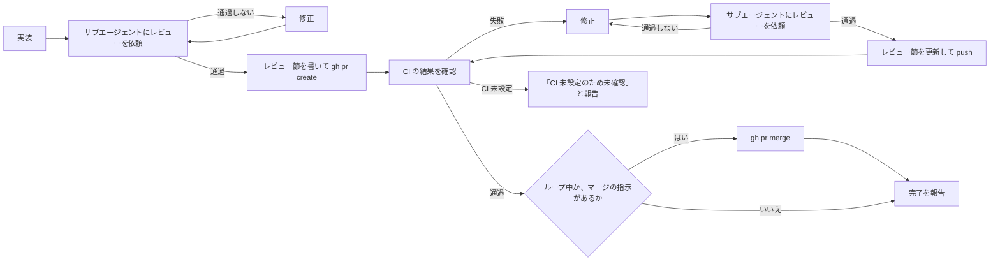

# creating-pr — 実装を PR にする手順

実装は、別のサブエージェントのレビューを通過してから PR にし、CI の結果を確かめてから完了と報告する。
書いた側の前提を持たない読み手でないと、抜けや食い違いを見つけられず、PR を作っただけでは動くかが分からないため。
マージは、ループ中かユーザーの指示があるときだけ行う（手順 7）。



## 制約

1. レビューを通過するまで `gh pr create` を実行しない。CI の修正も、レビューを通過するまで push しない
2. PR を作っただけで完了と報告しない。CI の結果を確かめてから報告する
3. CI がまだ無いうちは「CI 未設定のため未確認」と報告し、通過したとは書かない
4. マージは、複数の issue を続けて実装するループの中か、ユーザーがその PR を対象に含むマージの指示（個別でも包括でも）をしたときだけ行う。どちらでもなければ PR を作って報告し、マージはユーザーに任せる。CI が通っていない PR と、CI 未設定で確かめられない PR はマージしない

## 1. 実装する

対応する issue の番号を入れたブランチを切って実装する（例：`feat/1-<短い名前>`）。コミットの切り方は user 側の skill `committing` に従う。`git add -A` は使わず、変更したファイルを指定して足す。リポジトリ直下の `HANDOFF.md` のような、コミットしないファイルが置かれていることがあるため。user 側の skill が無い環境では、参照を飛ばしてこの手順だけで進める。

## 2. サブエージェントにレビューを依頼する

Agent ツールでサブエージェントを起動し、次を渡す。

Agent ツールには `name` を付けない。name を付けて起動したレビュアーが、指示を待つ表示のまま 2 時間以上結果を返さなかったことがあったため（原因は確かめていない）。

| 渡すもの | 理由 |
|---|---|
| 対応する issue の番号（`gh issue view <番号>` で読ませる） | 照合の相手。要約すると、書いた側の解釈が混ざる |
| 差分の範囲（`git diff main...HEAD`） | レビューの対象 |
| 観点：`conformance-reviewing` に照らした issue の完了条件との照合、テストと型検査の実行結果 | 観点を指定しないと、感想になる |
| 返し方：指摘ごとに「箇所 / 問題 / 直し方の案 / 重要度（必須・推奨）」。推測は推測と明記。ファイルは修正しない | 通過の判定に重要度が要る。直すのは書いた側 |

2 回目以降は、最初の Agent の結果に返るエージェントの ID を宛先にして SendMessage で再レビューを頼み、前回の指摘が解消したかと、修正で新しく出た問題を見てもらう。

## 3. 通過を判定する

通過とは、**必須の指摘が 0 件で、推奨の指摘はすべて対応したか、見送った理由を書いた状態**とする。

- 通過しなければ修正し、2 に戻る
- 必須の指摘を直したら、必ずもう一度レビューを受ける。直した結果を誰も見ていないため
- 指摘のうちユーザーが決めること（issue に無い決定など）は、自分で決めずにユーザーに確認してから反映する

## 4. レビュー節を書いて PR を作る

本文は scratchpad のファイルに書き、書き方は user 側の skill `issue-pr-writing` に従う。本文に `Closes #<issue 番号>` と「レビュー」節を入れる。レビュー節には、回ごとに件数と、指摘ごとの扱いを書く。サブエージェントのレビューはセッションの中で終わるため、残さないと走ったかを後から確かめられない。

```markdown
## レビュー

PR 作成前にサブエージェントのレビューを N 回受けた。（通過の状態を 1 文で）

### 1 回目（必須 X・推奨 Y）

| 指摘 | 扱い |
|---|---|
| …（必須） | … |
```

```sh
git push -u origin HEAD
gh pr create --title "<タイトル>" --body-file <本文のファイル>
```

## 5. CI の結果を確かめる

```sh
gh pr checks <PR 番号> --watch
```

| 結果 | 次にやること |
|---|---|
| すべて通過 | 7 に進む |
| 失敗がある | 6 に進む |
| `no checks reported on the '<ブランチ>' branch` と出る | 下のとおり、CI 未設定かを確かめる |

チェックが 0 件のとき、`gh pr checks` は `--watch` を付けていても待たずに終わる。push の直後でチェックがまだ登録されていないときも同じ表示になるため、workflow があるかで分ける。

```sh
ls .github/workflows
```

- workflow が無い：CI 未設定。PR 本文に「CI 未設定のため未確認」と書き（`gh pr edit <PR 番号> --body-file <本文のファイル>`）、ユーザーにも同じように報告する。CI が無いと先に分かっていれば、PR を作るときに本文へ入れておく
- workflow がある：1 分ほど待ってから `gh pr checks` をもう一度実行する。3 回やってもチェックが 0 件なら、「チェックが登録されないため未確認」とユーザーに報告して止まる。workflow が pull_request で動かない設定のこともあり、待ち続けても終わらないため

## 6. CI の失敗を直す

```sh
gh run list --branch <ブランチ> --status failure --limit 1
gh run view <run ID> --log-failed
```

1. 失敗の原因を直してコミットする
2. 2 と同じ形で、レビューを依頼する。差分は、まだ push していない修正（`git diff origin/<ブランチ>...HEAD`）と、ブランチの全体（`git diff main...HEAD`）の両方を渡す。通過するまで push しない
3. PR 本文のレビュー節に、その回の結果を足す

   ```sh
   gh pr edit <PR 番号> --body-file <本文のファイル>
   ```

4. push して、5 に戻る

## 7. マージする

CI が通ったあと、次のどちらかのときだけマージする。どちらでもなければ、PR の URL を伝えて完了を報告し、マージはユーザーに任せる。

| マージしてよいとき | 理由 |
|---|---|
| 複数の issue を続けて実装するループの中 | 次の issue は前の PR のマージを前提にするので、待つとループが止まる。ユーザーがループの指示でマージを許可している |
| ユーザーがその PR を対象に含むマージの指示（個別でも包括でも）をしたとき | 指示そのものが承認 |

ループ中とは、今のセッションでユーザーから受けた指示か、ループの仕組みが毎回渡してくるプロンプトが、複数の issue を順に実装するよう求めているとき（「#A〜#B を loop で実装する」「issue を 3 つ続けて実装して」など）。会話の中にその指示が見つからなければループ中ではないとみなし、マージせず報告する。

```sh
gh pr merge <PR 番号> --merge --delete-branch
git checkout main && git pull --ff-only
```

- `--merge`: このリポジトリの履歴は `Merge pull request #N` の merge commit で揃えていて、squash はブランチの履歴を捨てるため
- `--delete-branch`: remote は GitHub の設定で消えるが、ローカルのブランチも消して main に戻るため
- 2 行目: PR ブランチにいるときは gh が main の checkout と `pull --ff-only` まで行う。PR ブランチにいないときと、gh の pull が警告だけで終わったときのために置く。git worktree の中では飛ばし、本体の worktree で行う

マージしたら、完了の報告に PR の URL と「マージ済み」を書く。ループ中は次の issue に進む。
