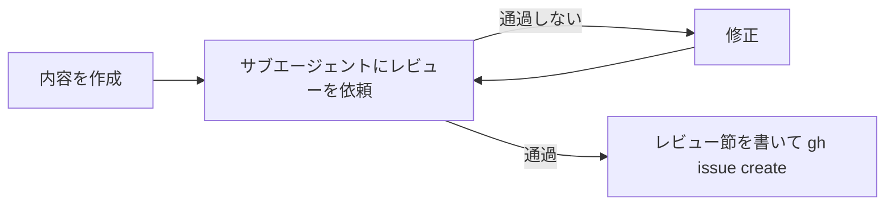

# filing-issue — issue を起票する手順

issue は、本文を作り、別のサブエージェントのレビューを通過してから起票する。
書いた側の前提を持たない読み手でないと、抜けや食い違いを見つけられないため。



## 制約

- レビューを通過するまで `gh issue create` を実行しない

## 1. 内容を作成する

本文は scratchpad のファイルに書く。書き方は user 側の skill `issue-pr-writing` に従う。その skill が無い環境では、参照を飛ばしてこの手順だけで進める。

## 2. サブエージェントにレビューを依頼する

Agent ツールでサブエージェントを起動し、次を渡す。

Agent ツールには `name` を付けない。付けると指示を待つ状態で起動し、レビューが始まらないことがあったため。

| 渡すもの | 理由 |
|---|---|
| ユーザーの依頼の原文 | 照合の相手。要約すると、書いた側の解釈が混ざる |
| タイトル案と本文のファイルパス | レビューの対象 |
| 観点：`issue-pr-writing` に照らした書き方、依頼との食い違い・欠け・依頼に無い追加、完了条件を第三者が判定できるか | 観点を指定しないと、感想になる |
| 返し方：指摘ごとに「箇所 / 問題 / 直し方の案 / 重要度（必須・推奨）」。推測は推測と明記。ファイルは修正しない | 通過の判定に重要度が要る。直すのは書いた側 |

2 回目以降は、同じサブエージェントに SendMessage で再レビューを頼み、前回の指摘が解消したかと、修正で新しく出た問題を見てもらう。

## 3. 通過を判定する

通過とは、**必須の指摘が 0 件で、推奨の指摘はすべて対応したか、見送った理由を書いた状態**とする。

- 通過しなければ修正し、2 に戻る
- 必須の指摘を直したら、必ずもう一度レビューを受ける。直した結果を誰も見ていないため
- 指摘のうちユーザーが決めること（依頼に無い決定など）は、自分で決めずにユーザーに確認してから反映する

## 4. レビュー節を書いて起票する

本文の末尾に「レビュー」節を足し、回ごとに件数と、指摘ごとの扱いを書く。サブエージェントのレビューはセッションの中で終わるため、残さないと走ったかを後から確かめられない。

```markdown
## レビュー

起票前にサブエージェントのレビューを N 回受けた。（通過の状態を 1 文で）

### 1 回目（必須 X・推奨 Y）

| 指摘 | 扱い |
|---|---|
| …（必須） | … |
```

```sh
gh issue create --title "<タイトル>" --body-file <本文のファイル>
```

起票したら、issue の URL をユーザーに伝える。
