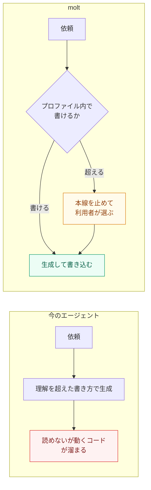
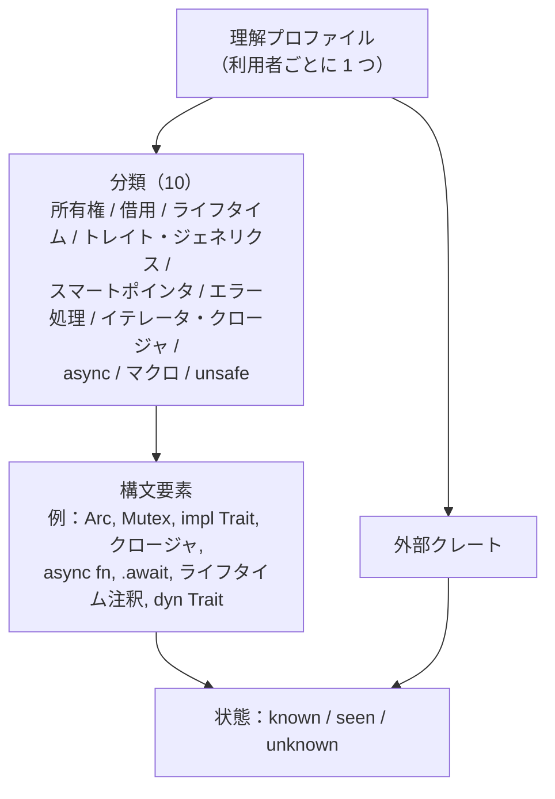
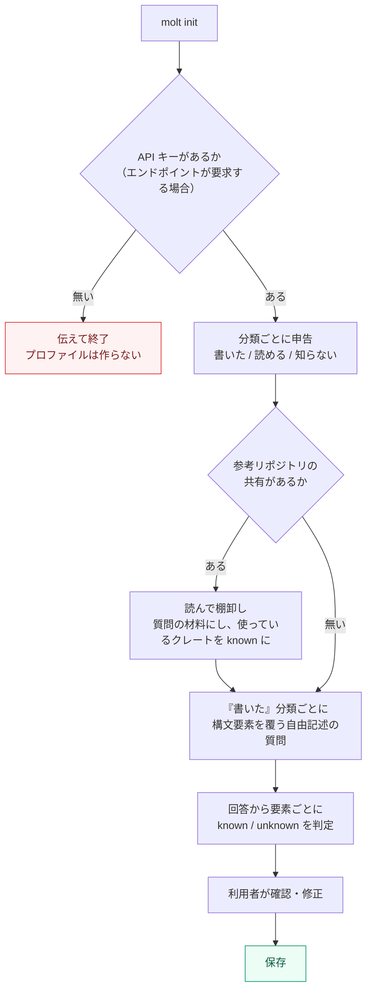
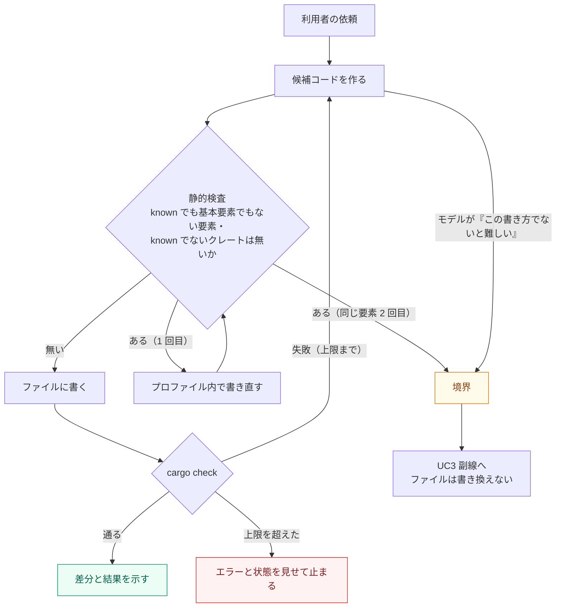
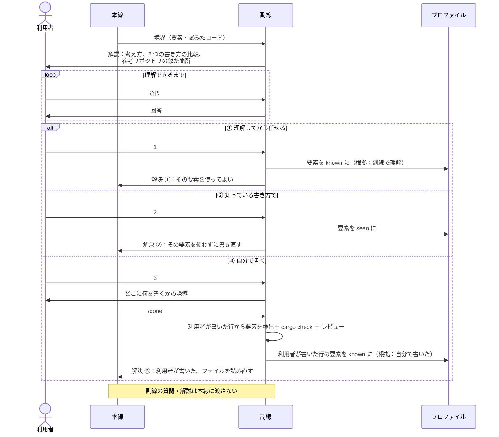
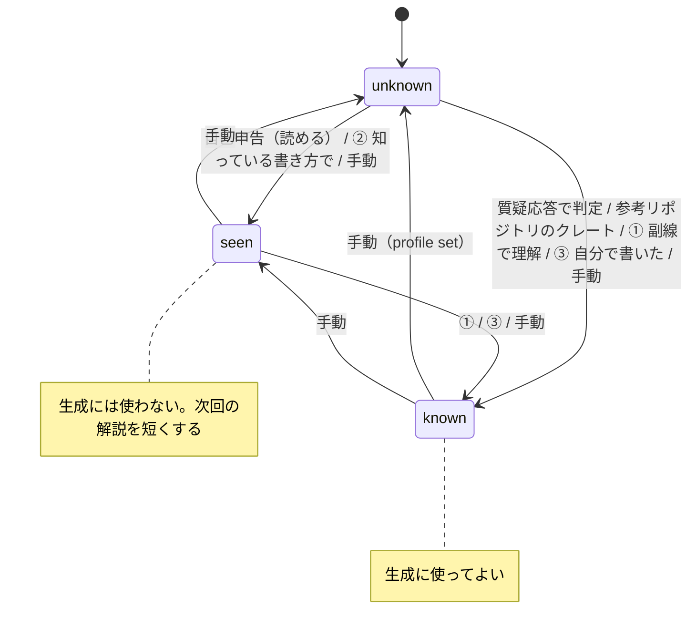
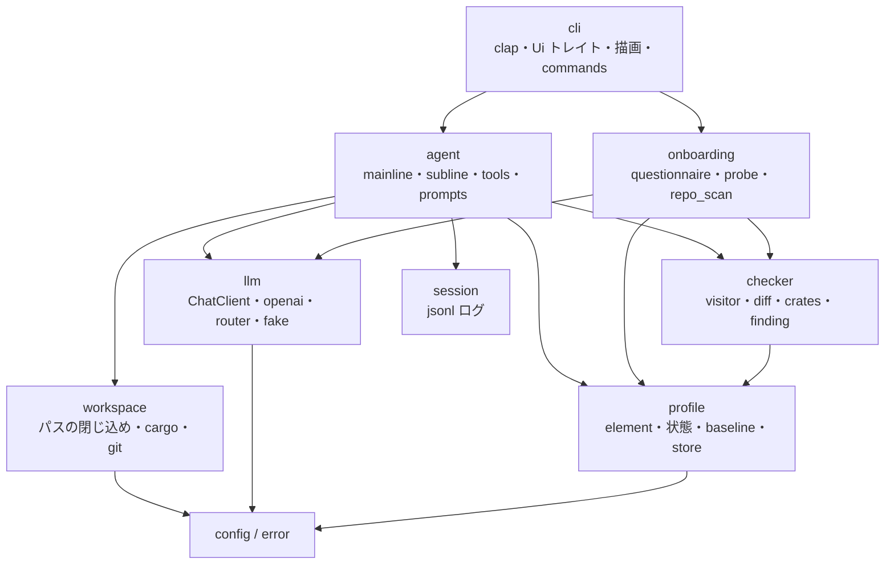
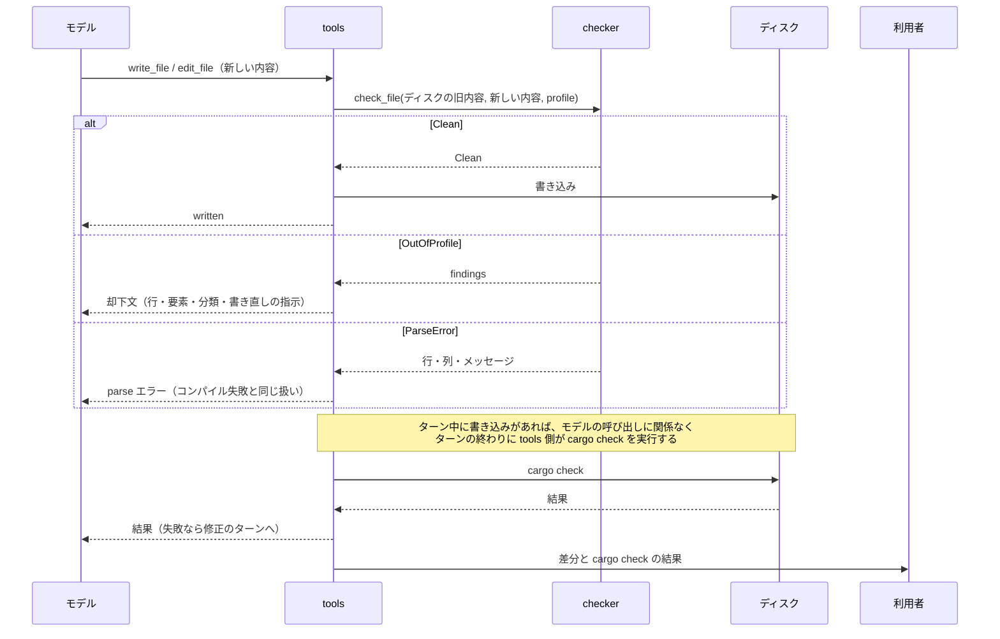
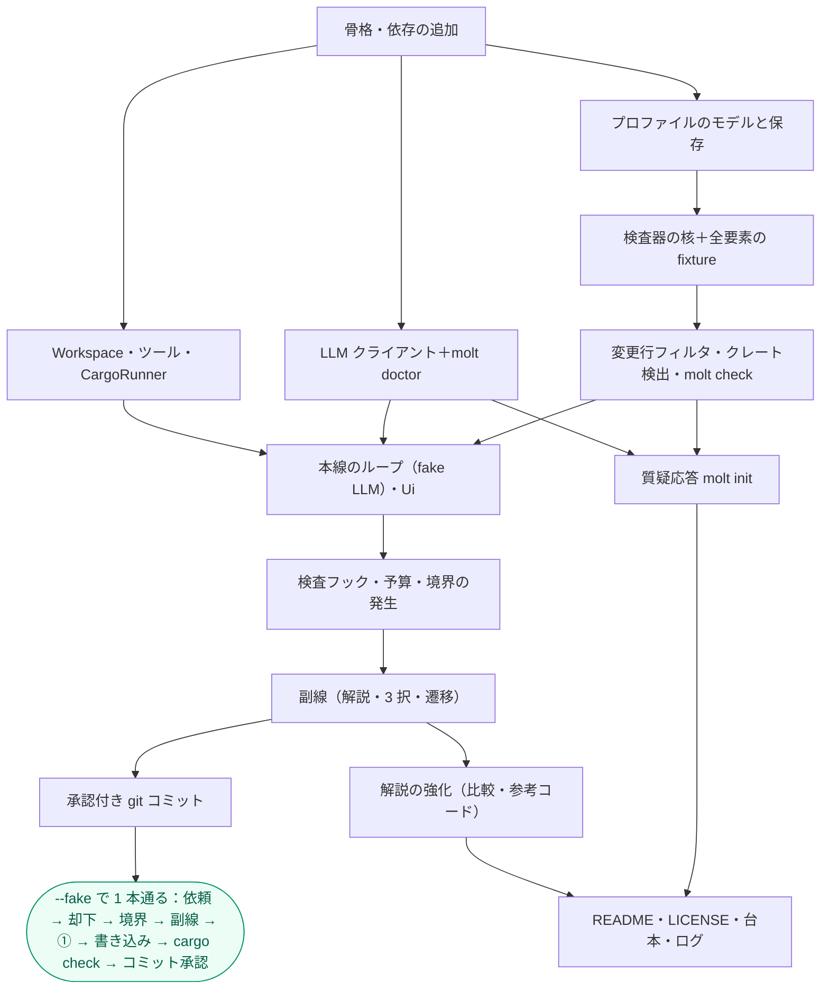

# PRD.ja.md — molt の要件と設計

[English](PRD.md)

molt（利用者が理解できる範囲の書き方でしかコードを書かない Rust コーディングエージェント）の要件と設計の正。
何のために作るか、何を保証するか、利用者は何をしたいか、それをどう組むかを書く。
進め方と今どの段階かは issue、起動方法は README、個々の API・設定・プロファイルの形はコードが持つ。
ハッカソン（Nebius x NVIDIA Global AI Hackathon）への応募作品だが、デモと提出物は本文書の対象外で、まずプロダクトとして成立させる。

---

## 1. 目的

AI でコードを大量に作れるようになった一方で、エンジニアは生成されたコードの中身を理解できず、開発しているのに経験が身につかない。
今のコーディングエージェントは、利用者がまだ書いたことのない書き方（例：`Arc<Mutex<T>>`）を断りなく使い、利用者は「読めないが動くコード」を自分のリポジトリに抱えることになる。

molt は、利用者が書ける範囲の書き方でだけコードを書き、その範囲を超えるときは本線を止めて利用者に選ばせる。
これで、開発を止めずに「理解できないコードが自分のリポジトリに入る」ことをなくす。学習はその結果であり、主役は開発。molt は先生ではなく、理解に合わせて書く同僚。



図から読み取ること：molt が変えるのは「理解を超えるとき」の 1 点で、超えない限りは普通のコーディングエージェントとして動く。

設計の考え方は認知負荷理論に沿う。減らすのは本質と関係ない負荷（理解を超えた書き方、一度に大量の差分）、残すのは理解を作る負荷（判断する、自分で書く、質問する）。
根拠に使う研究は Anthropic の RCT（AI 支援群の理解度クイズ平均 50%、手書き群 67%。生成後に質問して確認する使い方は 65% 以上）。研究自身が因果関係ではないと明記しているので、「研究で示唆されたパターンを設計原理にした」以上のことは言わない。

---

## 2. 用語



図から読み取ること：境界の判定は構文要素とクレートの単位で行い、解説は分類の単位でまとめる。

| 用語 | 意味 |
|---|---|
| 利用者 | molt を使って自分の Rust プロジェクトを開発するエンジニア |
| 理解プロファイル（プロファイル） | 構文要素・外部クレートごとの状態と根拠の集合。利用者ごとに 1 つ |
| 分類 | 構文要素をまとめる 10 の区分 |
| 構文要素 | 境界判定の最小単位。一覧の正はコードの `Element` と `tests/fixtures/elements/` |
| 基本要素 | 常に許す構文要素（例：共有参照 `&`、`Result`、`Option`、`?`、`println!` など std の基本マクロ）。Rust を書く上で避けられないため、プロファイルに関係なく生成に使える。一覧の正はコードの既定値 |
| 状態 | `known`（書ける。生成に使ってよい）/ `seen`（読める、または副線で見た。生成には使わない）/ `unknown`（未知。記載が無い要素はこれ） |
| 根拠 | 状態がそうなった理由。自己申告 / 質疑応答 / 参考リポジトリ / 副線で理解 / 自分で書いた / 手動 |
| 境界 | molt が書こうとしたコードに `known` でも基本要素でもない要素が含まれ、かつプロファイル内の書き方では実現が難しい状態 |
| 本線 | 利用者の開発の依頼を進める対話 |
| 副線 | 境界で本線を止めて開く、その要素に絞った対話。本線の対話の記録に現れない |

---

## 3. 保証すること

molt が書く行に `known` でない要素が入らないこと、境界では必ず利用者が選ぶこと、副線が本線の記録に現れないことを保証する。

| 観点 | 保証 |
|---|---|
| 核 | molt が書き込んだ行に、`known` でも基本要素でもない構文要素・外部クレートは含まれない |
| 核 | `known` でない要素が検出されたとき、利用者は必ず 3 択（理解してから任せる / 知っている書き方で / 自分で書く）から選べる。選ぶか依頼を取り下げるまで本線は進まない |
| 整合性 | 要素が `known` になるのは、利用者の回答（質疑応答）、副線での選択（① 理解した、③ 自分で書いた）、参考リポジトリで使っているクレート、手動の操作のときだけ。molt の判断だけで広がらない |
| 整合性 | 検査は書き込む前の内容に対して行い、検査を通らなかった内容はディスクに置かない |
| 整合性 | git コミットは利用者が承認した内容だけ。承認なしにコミット・push しない |
| 文脈の分離 | 副線で交わした質問・解説は、本線の対話の記録に現れない。副線から本線に戻るのは、選択の結果（解決の種類と要素名）と、② のときだけコードの方針 1 行 |
| 可観測性 | 検出した要素・却下した生成・選んだ選択肢・プロファイルの変更は、セッションの記録として残り、後から追える |
| 検証 | molt が書き込んだ後は `cargo check` を実行し、その結果（通らなければエラー）を利用者に見せる |
| 冪等 | 同じ要素が同じセッション内で何度出ても、`known` になった後は再び境界にならない |
| 言語 | 解説・質問・回答は利用者の直近の入力言語で返す。UI の固定文字列は英語 |
| セキュリティ | API キーは環境変数から読み、ファイル・ログ・セッションの記録に書かない。TLS 無しの `http://` でキーを送るのは loopback のホストだけで、loopback 以外のホストへの `http://` ではクライアントを作らない |

---

## 4. 保証しないこと

作りすぎを判定する根拠として、次は扱わない。

| 保証しないこと | 理由 / 扱う先 |
|---|---|
| 理解度クイズ・採点 | 理解の判定は質疑応答での自己申告と対話に委ねる |
| 生成コードの「正しさ」そのもの（仕様どおり動くか） | `cargo check`（と利用者が頼めば `cargo test`）で分かる範囲まで。それ以上は利用者がレビューする |
| 利用者が自分で書いたコードへの制約 | 利用者本人が書くものは制約しない。むしろ ③ の経路でプロファイルに加わる |
| 利用者が元から持っていたコードの検査 | molt が変えた行だけを検査する。既存のコードに `known` でない要素があっても止めない |
| プロファイル内の書き込みごとの承認 | 検査を通れば書く。承認を求めるのはコミットとクレートの追加だけ |
| 急ぎモード（制約を外す） | 対象外。将来の検討 |
| git 履歴からのプロファイル自動生成 | 参考リポジトリを共有されたときは、質疑応答の材料と、使っているクレートの読み取りに使うだけ |
| 理解マップの可視化、忘却への対応、理解できる単位での作業分割 | 対象外。将来の検討 |
| Rust 以外の言語 | 対象外 |
| Web UI・ホスティング・デモ URL・提出物 | 今は考えない。プロダクトとして成立させることを優先する |
| 複数利用者・チームでのプロファイル共有、同じプロファイルや同じプロジェクトでの同時実行 | プロファイルは利用者 1 人に 1 つ。同時に 2 つの molt を動かすことは想定しない（保存は後勝ち） |

---

## 5. 動かせない前提

| 種類 | 前提 |
|---|---|
| 技術 | LLM は OpenAI 互換の chat API（`/v1/chat/completions`。エンドポイントが要求する場合は Bearer 認証）で呼ぶ。既定と提出時の対象は Nebius Token Factory。API 仕様に function calling・`response_format`（json_object / json_schema）・`reasoning_effort` がある。各エンドポイントとモデルが実際に受理するかは `molt doctor`（8.7）で確かめる |
| 技術 | 既定と提出時のモデルは NVIDIA Nemotron。カタログで確認したところ Lightning / Nano / Super / Ultra の 4 つがあり、いずれも function calling 対応と記載。既定の ID は 8.7。それ以外のモデルは、`doctor` を通った検証の相手に限る（8.7） |
| 技術 | 実装は Rust（1.99.0、edition 2024）。CI は fmt / clippy（`-D warnings`）/ test |
| 技術 | 利用者の対象プロジェクトは cargo プロジェクト（`cargo check` が動く） |
| 業務 | 締切 2026-10-30 10:00 PDT（2026-10-31 02:00 JST）。提出目標 10/29。1 人で作る |
| 業務 | 公開リポジトリ・OSS ライセンス（Apache 2.0 / MIT 等）が提出要件 |

---

## 6. ユースケース

### UC1 理解プロファイルを作る（初回設定）

利用者は分類ごとに自己申告し、「書いたことがある」と答えた分類だけ molt が構文要素の単位で自由記述の質問をして確かめる。



図から読み取ること：質問は「書いた」と申告した分類にしか出ないので、申告の数で所要時間が決まる。

- 事前条件：プロファイルがまだ無い（または作り直しを選んだ）。エンドポイントが API キーを要求する場合、その環境変数（既定 `NEBIUS_API_KEY`）がある
- 主フロー：申告 → （参考リポジトリ） → 質問と判定 → 確認 → 保存。申告の反映は「書いた」→ 質疑応答の結果（要素ごとに `known` / `unknown`）、「読める」→ その分類の要素を `seen`、「知らない」→ `unknown`
- 主フロー：外部クレートは init では聞かない。参考リポジトリの共有があれば、その `Cargo.toml` の依存を `known`（根拠：参考リポジトリ）にする。それ以外のクレートは最初に使おうとしたときに境界になる（UC3）
- 代替フロー：すべて「知らない」 → 質問を飛ばし、基本要素だけのプロファイルを保存する
- 代替フロー：既にプロファイルがある → 上書きするか確認し、拒否されれば何も変えない
- 例外フロー：共有されたパスが存在しない / cargo プロジェクトでない → 伝え、参考無しで続ける
- 例外フロー：質疑応答の途中で API が失敗（認証・レート制限・ネットワーク） → 原因を伝えて終了し、途中のプロファイルは保存しない
- 例外フロー：途中で中断 → 途中のプロファイルは保存しない
- 同時に 2 つの `molt init` が走る場合は想定しない（4 節。保存は後勝ち）
- 事後条件：構文要素とクレートごとに状態・根拠・日時が保存されている。`known` の要素はすべて、利用者の回答か参考リポジトリに由来する

### UC2 プロファイル内で開発を進める（本線）

生成したコードは静的検査を通ったものだけがファイルに書かれ、避けられない要素は境界として副線に渡す。



図から読み取ること：コンパイル失敗は境界ではない。境界になるのは「`known` でない要素を避けられない」ときだけ。

- 事前条件：プロファイルがある。カレントディレクトリが cargo プロジェクト
- 主フロー：依頼 → 候補 → 検査 → 書く → `cargo check` → 差分と結果を示す。検査を通った書き込みに承認は求めない
- 代替フロー：検査で `known` でない要素が見つかる → プロファイル内の書き方で書き直す。通れば書く
- 代替フロー：`cargo check` が失敗 → エラーを使って直し、再び検査から。上限（8.4）を超えたら、エラーと最後の状態を見せて止まる
- 代替フロー：`known` のクレートがまだ `Cargo.toml` に無い → `cargo add` するか利用者に確認し、承認されたときだけ追加する。`known` でないクレートは検査で止まり、境界になる（UC3）
- 例外フロー：同じ要素が 2 回却下される、またはモデルが「この書き方でないと難しい」と判断 → 境界として UC3 へ。ファイルは書き換えない
- 例外フロー：1 ターンのツール呼び出しが上限（8.4）を超える → そこまでの状態を見せて止まる
- 例外フロー：cargo プロジェクトでない → 伝えて止まる
- 例外フロー：API が失敗（認証・レート制限・ネットワーク） → 原因を伝え、ファイルは変えない
- 同じプロジェクトで 2 つの molt が動く場合は想定しない（4 節）
- 事後条件：molt が書き込んだ行に `known` でも基本要素でもない要素は無い。`cargo check` の結果が利用者に示されている

### UC3 境界で選ぶ（副線）

副線は解説から始まり、利用者が理解できるまで質問でき、3 択で本線に戻る。



図から読み取ること：要素が `known` になるのは ① と ③ だけ（② は `seen`）。本線に戻るのは解決の種類と要素名で、② ではこれにコードの方針 1 行が付く。

- 事前条件：UC2 で境界に至った。本線は止まっている
- 主フロー：解説 → 質問（任意・回数制限なし） → 選択 → 本線へ
- 選択 ①：要素を `known` にし、本線はその要素を使って続ける
- 選択 ②：要素を `seen` にし、本線はその要素を使わずに書き直す。書き直せなければ、できない理由を示して止まる
- 選択 ③：molt は書かず、どこに何を書くかを誘導する。利用者が書いて `/done` → 利用者が書いた行を読み、`cargo check` を走らせ、レビューを返す。利用者が書いた行に含まれる `known` でない要素はすべて `known` になる（根拠：自分で書いた）。境界がクレートなら、利用者が `Cargo.toml` に足したクレートが `known` になる
- 代替フロー：③ で `cargo check` が失敗 → 結果を見せ、利用者は直して再び `/done` するか、① ② に切り替える。プロファイルは `/done` が通るまで変えない
- 代替フロー：③ で何も書かずに `/done` → 変更が無いことを伝え、選び直す
- 代替フロー：依頼を取り下げる（`/abort`） → ファイルもプロファイルも変えず、本線は次の依頼を待つ
- 例外フロー：副線で中断（Ctrl-C） → 何も変えず、本線を「境界で止まった」状態に戻す。利用者は選び直すか取り下げる：`/side` で同じ副線に戻り（解説は繰り返さず、質疑の続きから）、`/abort` で取り下げる
- 例外フロー：1 度に複数の要素が境界になる → 1 つずつ扱う（分類が同じなら束ねてよい）。すべてに選択が付くまで本線は進まない
- 例外フロー：② の後、同じターンで同じ境界が再発 → 2 度目で止まり、その書き方が要ることを伝えて ① か ③ を勧める
- 事後条件：① ③ では要素が `known`、② では `seen` になっている。それ以外の要素は変わっていない。本線の対話の記録に副線の質問・解説は無い

### UC4 変更をコミットする

コミットは利用者が差分とメッセージ案を見て承認したものだけ。

- 事前条件：molt の書き込みがあり、`cargo check` が通っている。カレントディレクトリが git リポジトリ
- 主フロー：利用者が頼む（または molt が提案）→ molt が変えたファイル（`cargo add` による `Cargo.toml` と `Cargo.lock` を含む）の差分とメッセージ案を見せる → 承認 → その内容だけをステージしてコミット。副線の ③ で利用者が書いたファイル（UC3）も molt が変えたファイルに含め、その行も 1 つの変更として差分とコミットに入れる
- 代替フロー：他に未ステージの変更が混ざっている → 伝え、molt が変えたファイルだけをステージするか利用者に確かめる
- 例外フロー：承認しない → 何もしない。差分は作業ツリーに残る
- 例外フロー：コミットする差分が無い → 伝えて何もしない
- 例外フロー：直前の `cargo check` が失敗したまま → その事実を警告し、それでもコミットするか確かめる
- 例外フロー：git リポジトリでない → 伝えて何もしない
- 例外フロー：`git commit` が失敗（hook、`user.name` 未設定など） → エラーを見せ、コミットされていないことを伝える。ステージは解かない
- 事後条件：承認した内容だけがコミットされている。push はしていない

### UC5 プロファイルを見る・直す

利用者は要素ごとの状態と根拠を一覧でき、手で状態を変えられる。

- 事前条件：プロファイルがある
- 主フロー（見る）：`molt profile show` で、分類ごとに要素の状態・根拠・日時を一覧する。基本要素は最後にまとめて示す
- 主フロー（直す）：`molt profile set <要素> <状態>` で状態を変える。根拠は「手動」、変更は履歴に残る。基本要素を `unknown` にすると、その要素は基本要素から外れる（`deny`）。`known` に戻すと `deny` から外れる
- 例外フロー：存在しない要素名 / 無効な状態 → 拒否し、有効な名前・状態を示す。何も変えない
- 例外フロー：プロファイルが無い → `molt init` を促す
- 変更は、次に起動した本線の最初の生成から反映される（動いている本線には反映されない）。`known` でなくした要素は再び境界になる
- 事後条件：変えた要素の状態と根拠「手動」が保存され、履歴に 1 件増えている

---

## 7. プロファイルの状態遷移

要素の状態は 3 つで、生成を許すのは `known` だけ。



図から読み取ること：molt の判断だけで `known` になる経路は無い。必ず利用者の申告・回答・選択、または利用者が共有したリポジトリを経る。

---

## 8. 設計

### 8.1 主要な判断

| 判断 | 選択 | 理由 |
|---|---|---|
| crate 構成 | 単一 crate、`lib` + 薄い `bin` | 規模が小さい。モジュール境界と `ChatClient` トレイトでネット無しのテストは足りる |
| 構文解析 | syn 3（`full` + `visit` + `extra-traits`）、`proc-macro2` の `span-locations` | 検査対象は書き込み前の完全なファイル。syn で parse できないものは cargo でも通らないので、部分解析に強い tree-sitter の利点が生きない。C ツールチェーン不要 |
| LLM クライアント | reqwest + serde_json の自作（`ChatClient` トレイトの背後） | Nemotron 固有の応答フィールドと、送る項目を自分で制御したい |
| git | `git` コマンドをシェルアウト（固定 argv） | status / diff / add / commit の 4 操作だけ |
| 入力 | clap + rustyline（履歴・編集。承認と選択も行で打つ） | 素の stdin は履歴が無く使いづらい。入力の経路を 1 つにすると、入力を読んでいる間の Ctrl-C は常に rustyline の中断になり、承認・選択では molt を終えずに答えなしになる。dialoguer の対話は Ctrl-C で SIGINT を送る。モデルの応答を待つ間の Ctrl-C は今も molt を終える |
| 検査のフック位置 | `write_file` / `edit_file` が受け取った内容を、ディスクに書く前に文字列として検査する | 「検査を通らなかった内容はディスクに置かない」を構造で守る。検査が文字列の純関数になる |
| 検査の範囲 | 変更された行に限る | 利用者が元から持っていたコードが、無関係な編集を止めないようにする（4 節） |
| 本線・副線の分離 | メッセージ列を本線用と副線用で別に持つ | 「副線は本線の記録に現れない」を構造で守る |
| プロファイルの置き場 | `$MOLT_HOME` → `$XDG_CONFIG_HOME/molt` → `~/.config/molt` | 理解は利用者に属するのでリポジトリではなく利用者の設定に置く |

### 8.2 モジュールと依存



図から読み取ること：`checker` と `profile` は I/O を持たず、ネット無しで単体テストできる。LLM と cargo はトレイトの背後にあり、テストでは偽物に差し替える。

### 8.3 データモデル

- `Category`（10）と `Element`（閉じた enum）。`Element::category()` を網羅 match で持つ。要素の一覧の正はコードの `Element` と `tests/fixtures/elements/`
- `ItemKey = Element | Crate(String)`（toml キーは `arc` / `"crate:tokio"`）
- `Profile`：要素ごとの `{ status, provenance, at, evidence }`、分類ごとの申告、基本要素の追加・除外（`allow` / `deny`）、履歴（追記のみ）
- 基本要素の既定はコードが持つ。`clone()` は入れない（所有権の分類の核）。利用者は `deny` で基本要素を外せる
- `CheckReport = Clean | OutOfProfile(Vec<Finding>) | ParseError`。ParseError はコンパイル系の失敗として扱い、境界にしない
- マクロ呼び出しの中身は syn では見えない。Rust の式を引数に取る std マクロ（`print!`・`format!` / `write!`・`vec!`・`assert!`・`dbg!`・`matches!`・`panic!` の各族。`asm!` は除く）は、引数を式とパターンとして parse し、周りのコードと同じに検査する。finding はそれぞれ、要素を作るトークンの行に置く。書式文字列のインラインの引数（`{x}`）は名前しか書けないので見ない。マクロの形で parse できない引数は見えず、その呼び出しを `macro_call` の finding にもする。それ以外のマクロの中身は見えない → 呼び出しが基本要素でも `known` でもなければ、呼び出し自体を finding にする
- 新規クレートは `Cargo.toml` の依存キーの差分と、ソース中のパスの先頭セグメント（std / core / crate / self / super / 自プロジェクトのモジュール以外）の両方から検出する

### 8.4 書き込みの経路



図から読み取ること：ディスクに届くのは Clean と判定された内容だけ。却下された内容はモデルにだけ返り、利用者にもディスクにも出ない。`cargo check` はモデルが呼ばなくてもエージェント側が走らせるので、3 節「検証」はモデルの振る舞いに依存しない。

ツール：`list_files` `read_file` `write_file` `edit_file` `run_cargo` `git_status` `git_diff` `git_commit`（承認必須）`request_boundary(items, reason, proposed_code)` `finish`。
`write_file` / `edit_file` が書けるのは、検査が読める Rust ソース（`.rs`）と `Cargo.toml` だけ。それ以外のファイルは、内容が検査されずに build に届きうる（`#[path]`、`.cargo/config.toml`）ので書かない。
`run_cargo` が受け付けるのは `check` `test` `clippy` `build` `fmt` `add` だけ（`add` は承認必須、`run` や任意のサブコマンドは受け付けない）。
1 ターンの予算：同じ要素の却下 2 回、コンパイル修正 3 回、ツール呼び出し 40 回。却下が 2 回に数えられるのは、モデルがそれを見た次の応答からで、1 つの応答の中の書き込みはどれも 1 回目の却下になる。コンパイル修正は、parse できない内容と、ターン末の `cargo check` の失敗のたびに 1 回求め、3 回のあとの失敗でターンを止める。境界ではターンが利用者の選択を待って保留になるので、`cargo check` も待つ。利用者が依頼を取り下げたら、境界より前に書いたものに `cargo check` を走らせ、差分と結果を表示する。質疑応答（UC1）の予算：1 分類につき質問 1 問、追加の質問は 1 問まで。

### 8.5 副線から本線へ渡すもの

本線に入るのは 1 メッセージだけで、形は 3 つ。

| 解決 | 本線に入るメッセージ | プロファイル |
|---|---|---|
| ① unlock | `BOUNDARY RESOLVED: unlock` ＋ 許可した要素名。元の方針で進めてよい | known（unlocked） |
| ② rewrite | `BOUNDARY RESOLVED: rewrite` ＋ 禁止のままの要素名 ＋ 副線の記録から light モデルが作った方針 1 行 | seen |
| ③ user_wrote | `BOUNDARY RESOLVED: user_wrote` ＋ 許可した要素名。ファイルを再読するよう指示 | known（wrote_themselves） |

### 8.6 CLI

```text
molt                      cwd の cargo プロジェクトで本線を開く（プロファイル無しなら init を促す）
molt init [--repo PATH]   質疑応答でプロファイルを作る。--repo は参考リポジトリの棚卸し
molt profile show|set <key> <status>|path
molt check [PATHS..]      検査器を単体で走らせ、finding を表示（あれば exit 1）
molt doctor               設定したエンドポイントとモデルの対応確認
```

共通フラグ：

| フラグ | 差し替えるもの | 理由 |
|---|---|---|
| `--profile PATH` | プロファイルの読み書き先 | 設定ディレクトリのプロファイルを触らずに別のプロファイルを試す |
| `--fake PATH` | モデルの応答を、台本ファイルと `FakeChatClient` で | モデル無しでオフラインに動かす |
| `--ui-script PATH` | 利用者の入力・選択・承認・中断を、台本ファイルと `ScriptedUi` で。出力は標準出力に出す | 人が端末に付かなくても、コーディングエージェントが実モデルに対する 1 本を通せるようにする |

本線のプロンプトは `molt> `、副線は `molt [sub: arc, mutex]> `。副線に入る・抜けるときは罫線のバナーを出し、副線内の出力は 2 スペース下げる。境界で止まった本線は `/side` と `/abort` だけを受ける（UC3）。そこでの Ctrl-C・Ctrl-D と、副線での Ctrl-D は、本線のプロンプトと同じく molt を終える。副線は、自分のコマンドでない `/` で始まる行をモデルに送らない。解説が得られなければ、副線はそれを伝え、質問は受け続ける。
副線で `/choose` を打つと、選択肢を番号で並べる。そこでの Ctrl-C は選ばなかったことになり、副線が続く。同じターンで先に ② を選んだ要素が境界に含まれるときは、その書き方が必要だと伝え、② を出さない。選んだ後にプロファイルを保存できなければ、molt はそれを伝え、選択はそのセッションの中では効く。
3 節の「言語」は、UI の固定文字列を英語で持ち、モデルに「利用者の直近の入力言語で答える」と指示することで満たす（言語の判定コードは持たない）。

### 8.7 モデルの役割と設定

| 役割 | 既定の ID（カタログで確認済み） | 用途 |
|---|---|---|
| light | `nvidia/Nemotron-3_5-Lightning` | 質疑応答の判定、副線→本線の 1 行要約、ログ整形 |
| generate | `nvidia/nemotron-3-super-120b-a12b` | コード生成・書き直し、③ のレビュー |
| reason | `nvidia/Nemotron-3-Ultra-550b-a55b` | 境界の判断、プロファイル内の代替案、解説、副線の質疑応答、質問の生成 |

`nvidia/NVIDIA-Nemotron-3-Nano-30B-A3B` は light の代替候補。既定値の正は `config.toml` を読むコード。
設定は `config.toml`（`[api]` `[models]` `[reasoning_effort]` `[capabilities]`）。`[api]` はエンドポイントを指す。API キーが要るかはエンドポイントごとに違い、キーは環境変数から読む（3 節）。キーの要らないエンドポイントは `api_key_env = ""` にする。キーがあり、`base_url` が loopback（`localhost`・`127.0.0.0/8`・`::1`）以外のホストへの `http://` なら、クライアントを作らない。キーを平文で機械の外に出さないため。`[capabilities]` は `molt doctor` が書く。
`molt doctor` は各役割のモデルに対し、ID の存在、素の chat、`tool_choice: required` でのツール呼び出し、`response_format: json_schema` の遵守、`reasoning_effort` の挙動を確かめて表にする。`json_schema` が使えないモデルでは、`json_object` ＋ プロンプトにスキーマ ＋ serde 検証 ＋ 1 回修復に切り替える。

エージェントをモデルに対して確かめる層は 3 つあり、どれも他の代わりにならない。

| 層 | エンドポイント | 確かめること | 走らせる場所 |
|---|---|---|---|
| `--fake` | 台本を持つ `FakeChatClient` | 制御の流れと 3 節の保証を、決定論的に | CI と手元のテスト |
| ローカルモデル | ローカルの OpenAI 互換エンドポイント。モデルは `doctor` を通るものなら何でもよい | プロンプトが実際にツール呼び出し・書き直し・境界の判断・解説を引き出すこと。クレジットを使わずに | 開発中に手または `--ui-script` で、および `#[ignore]` のテストで |
| Nemotron | Nebius Token Factory | 提出時の設定で `doctor` と 10 節の 1 本が通ること | 提出前に手で |

### 8.8 永続化

プロファイルとセッションの記録の形はコード（`profile/store.rs`、`session.rs`）が正。ここには形の理由だけを書く。

| 決め | 理由 |
|---|---|
| 要素の状態は上書きし、遷移は履歴（`[[history]]`）に追記する | 「いつ・何がきっかけで `known` になったか」を後から辿れる。将来の理解マップの材料にもなる |
| 根拠（provenance）と日時を要素ごとに持つ | 3 節「molt の判断だけで広がらない」を、保存された内容から確かめられる |
| 保存は一時ファイルに書いてから rename する | 途中で失敗しても壊れたプロファイルを残さない |
| セッションの記録は 1 行 1 イベントの jsonl。副線のイベントは `line: "sub"` を持つ | 本線と副線を記録上で区別でき、3 節「副線は本線の記録に現れない」を記録から確かめられる |
| セッションの記録にリクエストヘッダと API キーを書かない。LLM のリクエスト本文は `MOLT_LOG` が有効なとき（空と `0` 以外の値）だけ別ファイルに出す | 3 節「API キーをログに書かない」 |
| セッションの記録はプロファイルの置き場（8.1）の `sessions/` に、セッションごとに 1 ファイルで置く | 追うもの（検出した要素・選択・プロファイルの変更）は利用者の理解についての記録で、プロファイルと同じく利用者に属する。リポジトリの外に置けば、誤って commit されず、molt が読み書きするファイルにも混ざらない |
| セッションの記録を作れなければ本線を開かない。途中で書けなくなったら、ファイルごとに 1 度だけ利用者に知らせて、そのファイル無しで続ける | 起動時なら、原因（molt の置き場に書けない）を依頼の前に直せる。途中で止めると、依頼が書きかけのまま残る |

---

## 9. テスト

ネット無しで 3 節の保証を確かめる。

| 対象 | 方法 |
|---|---|
| checker | `tests/fixtures/elements/*.rs` の先頭 `// expect: …` と検出集合の完全一致。`fixtures/negative/*.rs` は基本要素以外 0 件。全 `Element` に fixture があることをテストで強制。変更行フィルタ（旧↔新）で既存の要素が出ないこと |
| profile | toml 往復、遷移で履歴が増える、未記載 = unknown、allow / deny、存在しない要素名・無効な状態の拒否 |
| llm | `FakeChatClient`（応答キュー＋送ったリクエストの記録）。wire 形式は JSON fixture と比較。実 API は `#[ignore]` で、`[api]` が指すエンドポイントに対して走らせる（8.7）。キーがあり loopback 以外への `http://` ならクライアントを作らず、loopback・`https://`・キー無しなら作る |
| agent（本線） | `FakeCargo` + tempdir。Clean → ディスクに書かれる。却下 → ディスクは変わらず、書き直しで通る。2 回却下で境界。`request_boundary` で境界。予算超過で止まる |
| agent（副線） | ① で known、② で seen、③ で利用者が書いた行の要素が known。③ で `cargo check` が失敗したらプロファイルは変わらない。① の後、同じ要素で再び境界にならない。本線のリクエスト履歴に副線のメッセージが無い。`/abort` で何も変わらない |
| agent（git） | tempdir の git リポジトリで、承認なし → コミットが増えない。承認 → molt が変えたファイルだけがコミットされ、push は呼ばれない |
| onboarding | `ScriptedUi` ＋ fake の判定で、申告「読める」→ seen、「知らない」→ unknown、「書いた」→ 判定どおり。参考リポジトリの `Cargo.toml` の依存が known。根拠と日時が保存される。中断 → 保存されない |
| session | 却下から境界に至る 1 回の実行で、jsonl に検出した要素・却下した生成・ツール呼び出し・`cargo check` の結果が残る。キーを書き返す loopback のエンドポイントに対して実クライアントに渡した API キーが、jsonl・`MOLT_LOG` のリクエスト本文・標準出力のどこにも現れない。`MOLT_LOG` が無ければリクエスト本文のファイルは作られない |
| cli | `ScriptedUi` で副線の選択を駆動。`assert_cmd` で `molt check` の exit code |

---

## 10. 実装の依存関係

モジュール間の依存から決まる着手の制約。進め方と進捗は issue が持つ。



図から読み取ること：検査器・LLM クライアント・Workspace は互いに依存しないので、本線のループより前ならどの順でもよい。本線から git コミットまでが 1 本通った時点が、製品として成立したかの目安。同じ 1 本を、そのあと実モデルに対して手または `--ui-script` で試す（8.7）。これは CI が走らせる `--fake` の 1 本の代わりにはならない。

---

## 11. リスクと手当て

| リスク | 手当て |
|---|---|
| Nemotron のツール呼び出しが不安定（引数 JSON が壊れる・テキストで返す） | `doctor` で早い段階に計測。引数は寛容に parse し 1 回再試行。未知ツールは有効名の一覧をエラーで返す。設定でモデルを差し替えられる |
| `json_schema` 非対応 | `doctor` で検出し、8.7 の切り替えで対応する |
| `reasoning_effort` を拒否される | `doctor` で確認し、`[capabilities]` が真のときだけ送る |
| syn が生成コードを parse できない | コンパイル系の失敗として行・列つきで返す。境界にしない |
| マクロ本体の中が見えない | Rust の式を引数に取る std マクロは、引数を parse して検査する（8.3）。それ以外の呼び出しは、基本要素でも `known` でもなければ呼び出し自体を finding にする。引数を parse できない std マクロも同じ。README に制限として書く |
| 分類をまたぐ要素（`Box<dyn Error>` 等） | 要素ごとに 1 件ずつ出し、解説で分類ごとにまとめて重複を除く。解禁は要素単位なので矛盾しない |
| 承認が開発のテンポを落とす | 承認はコミットと `cargo add` だけ（4 節）。検査を通った書き込みと cargo check / test / clippy は承認不要 |
| パス逸脱・破壊的操作 | ルート配下に canonicalize して閉じ込め、`.git/` `target/` は書き込み禁止。`run_cargo` のサブコマンドは列挙したものだけ。シェル文字列は使わず固定 argv |
| CI の `--locked` | `cargo add` のたびに `Cargo.lock` をコミットする（UC4 の対象に含める） |
