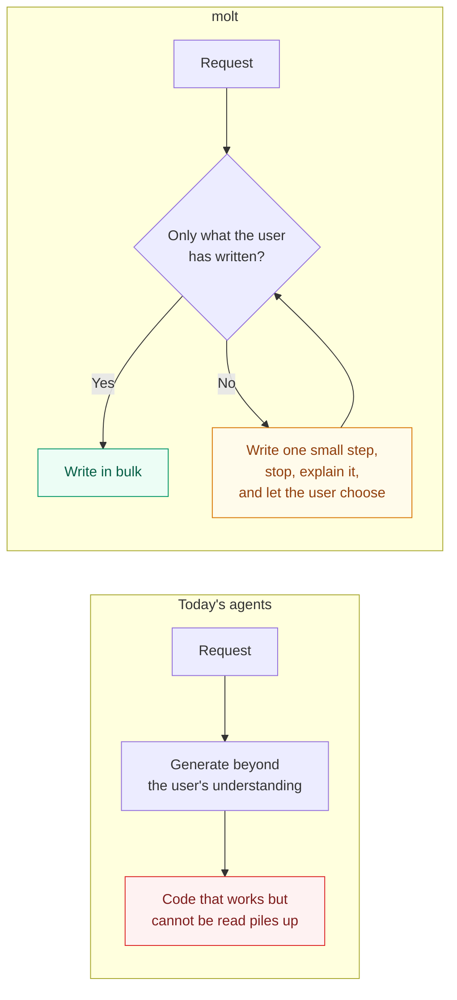
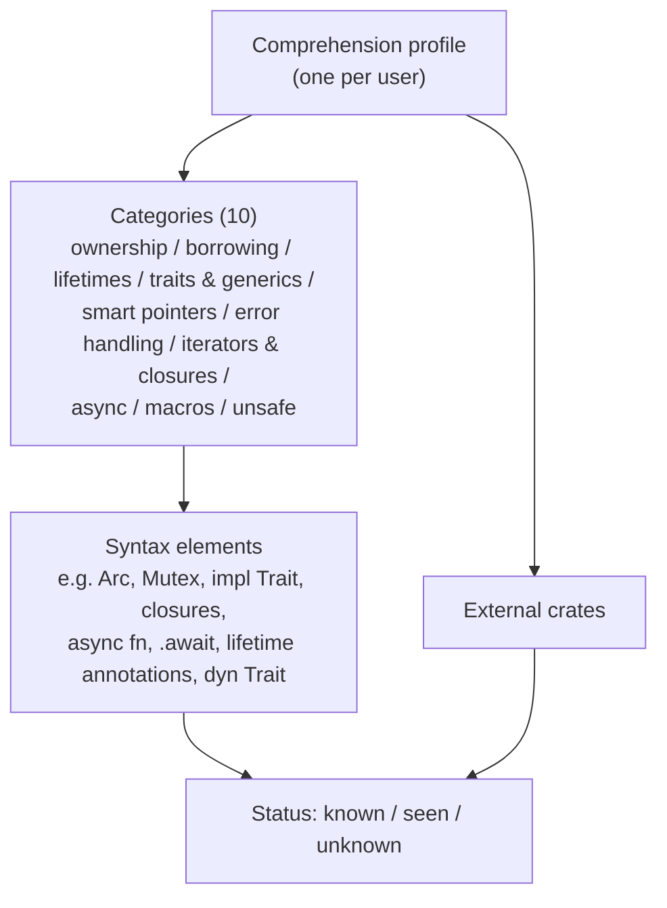
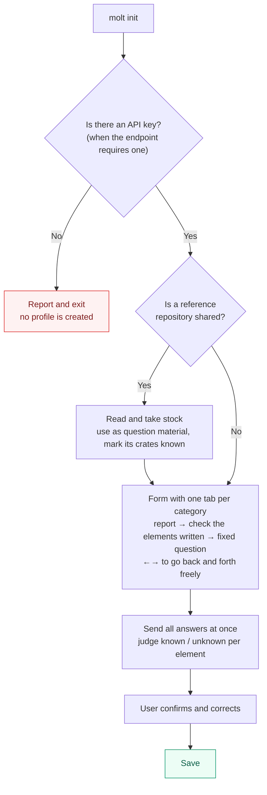
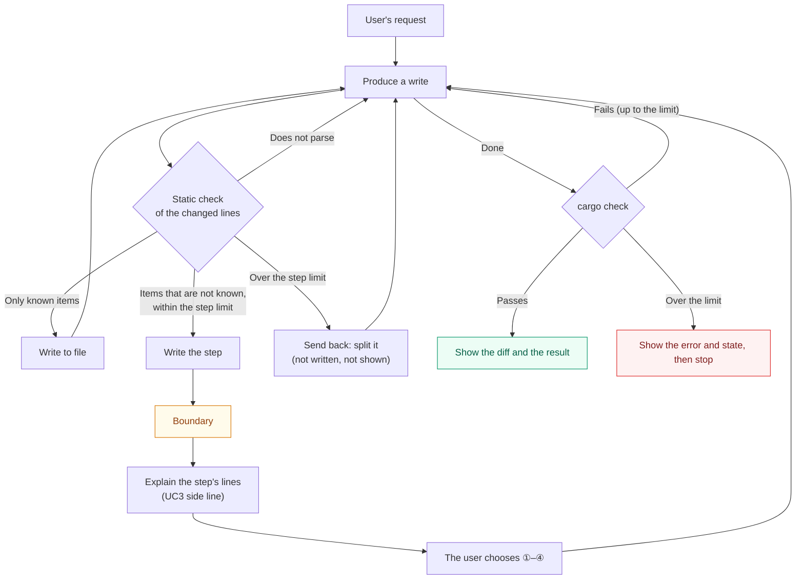
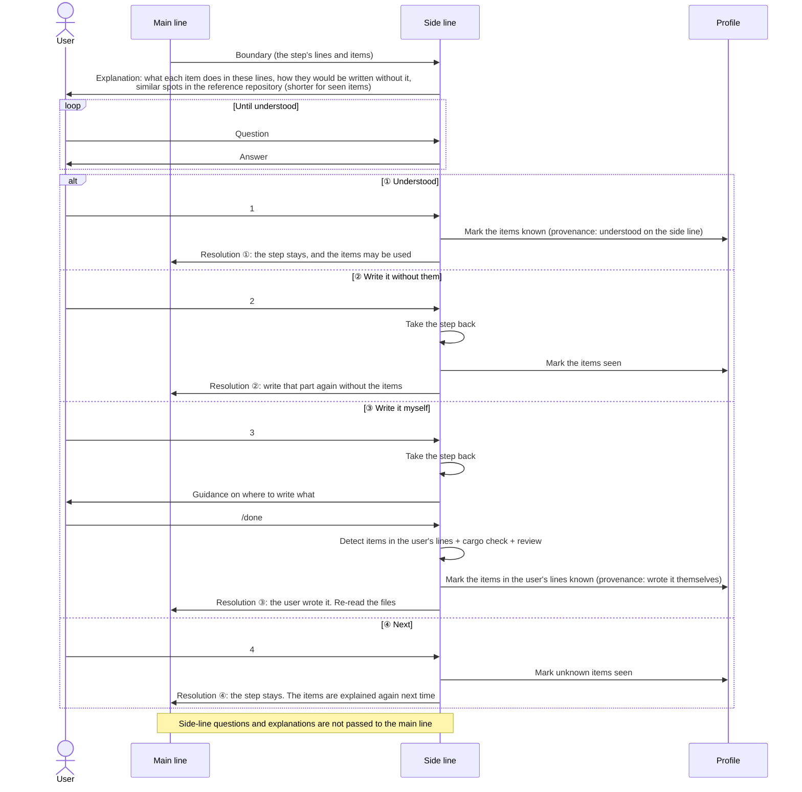
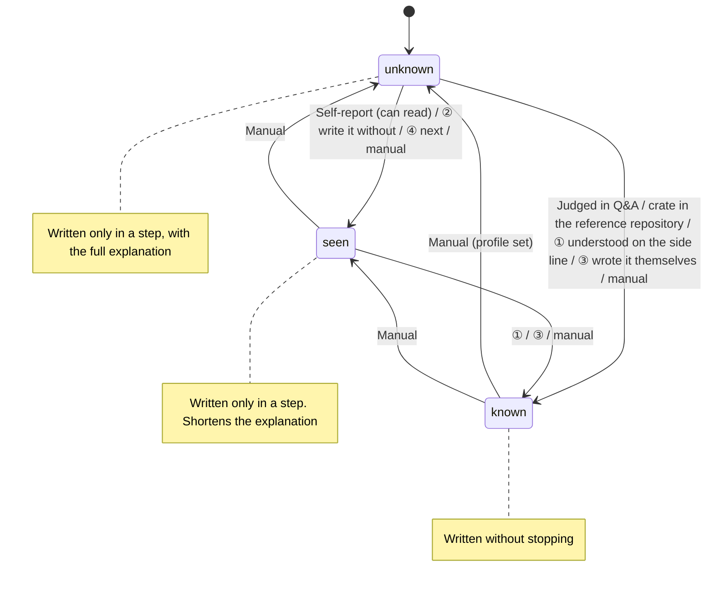
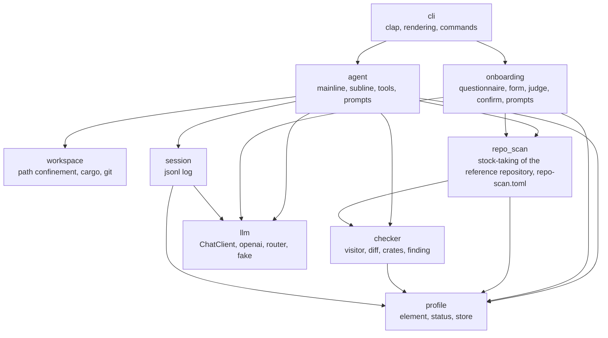

# PRD.md — molt requirements and design

[日本語版](PRD.ja.md)

The source of truth for the requirements and design of molt, a Rust coding agent that writes what its user already knows in bulk, and what they have not written yet one explained step at a time.
It states why molt exists, what it guarantees, what the user wants to do, and how it is put together.
Progress and the current stage live in issues, how to start lives in the README, and the shape of each API, config, and profile lives in the code.
molt is an entry for a hackathon (Nebius x NVIDIA Global AI Hackathon), but the demo and the submission are out of scope here; first it has to stand as a product.

---

## 1. Purpose

AI can now produce code in bulk, yet engineers cannot understand what was generated, so they develop without gaining experience.
Today's coding agents use constructs the user has never written (for example `Arc<Mutex<T>>`) without a word, and the user ends up holding "code that works but cannot be read" in their own repository.

molt writes code made of what the user has written before in bulk. Anything they have not written yet, it writes one small step at a time, and after each step it stops, explains those lines, and lets the user choose.
This removes "code I do not understand landing in my repository" without stopping development, and without writing around the constructs the user has yet to learn. Development is the main act, and the steps make the learning happen along the way instead of being skipped. molt is not a teacher but a colleague who writes at the user's level of understanding and explains as it goes beyond it.



What to read from the figure: the one point molt changes is "when the code uses something the user has not written"; as long as it does not, molt behaves as an ordinary coding agent.

The design follows cognitive load theory. What it reduces is load unrelated to the essentials (constructs the user has not met arriving without a word, a huge diff at once); what it keeps is the load that builds understanding (deciding, writing by hand, asking).
The research it leans on is Anthropic's RCT (comprehension quiz average of 50% for the AI-assisted group versus 67% for the hand-written group; asking questions after generation to confirm scored 65% or higher). The study itself states that this is not a causal relationship, so molt claims nothing beyond "the patterns the study suggested were taken as design principles".

---

## 2. Terms



What to read from the figure: steps are judged per syntax element and per crate, while explanations are grouped per category.

| Term | Meaning |
|---|---|
| User | An engineer who develops their own Rust project with molt |
| Comprehension profile (profile) | The set of status and provenance per syntax element and per external crate. One per user |
| Category | One of the 10 groups that syntax elements are sorted into |
| Syntax element | The smallest unit the profile and the check deal in. The source of truth for the list is `Element` in the code and `tests/fixtures/elements/`. Shared references `&`, `Result`, `?`, `for` and `println!` are elements like any other: there are no elements that are always allowed. Syntax outside the list (`let`, `fn`, `struct`, `match`, `if`, …) is not tracked |
| Status | `known` (has written it; molt writes it without stopping) / `seen` (can read it, or has had it explained at a boundary; molt writes it only in a step, with a short explanation) / `unknown` (not known; molt writes it only in a step, with the full explanation; any element with no entry is this) |
| Provenance | Why the status became what it is. Self-report / Q&A / reference repository / understood on the side line / wrote it themselves / manual |
| Item | A syntax element or an external crate |
| Step | One write by molt (`write_file` / `edit_file`) whose changed lines contain an item that is not `known`. A step holds at most 3 distinct such items (so at most 3 categories) and at most 30 changed lines; a write whose changed lines are a single line is a step however many items it holds. A write over that limit is sent back to the model to be split, and is neither written nor shown to the user (8.4) |
| Boundary | The pause right after molt writes a step: the main line waits, and the side line opens for that step |
| Main line | The dialogue that carries the user's development request forward |
| Side line | The dialogue opened at a boundary, with the main line paused, focused on the step's lines and items. It never appears in the main line's transcript |

---

## 3. Guarantees

molt guarantees that every line it writes with an item that is not `known` reaches the user through a step and a boundary, that the user always chooses at a boundary, and that the side line never appears in the main line's transcript.

| Aspect | Guarantee |
|---|---|
| Core | molt writes a line with an item that is not `known` only in a step: right after writing it, molt stops, shows the step's lines with an explanation of each such item, and opens the side line. Code made only of `known` items is written without stopping |
| Core | At a boundary the user can always choose from 4 options (① understood / ② write it without them / ③ write it myself / ④ next). The main line does not advance until the user chooses or withdraws the request. molt asks the model to write around an item only when the user chose ②: the system prompt does not present the profile as a limit on what to use, and a split request asks only for smaller steps |
| Consistency | An element becomes `known` only through the user's answers (Q&A), a choice on the side line (① understood, ③ wrote it themselves), a crate used by the reference repository, or a manual operation. It never spreads by molt's judgement alone; ④ (next) leaves an item short of `known` |
| Consistency | The check runs on the content before it is written. Content that does not parse, or that is too large to be a step, never lands on disk; content with an item that is not `known` lands on disk only as a step, followed at once by a boundary |
| Consistency | A git commit contains only what the user approved. molt never commits or pushes without approval |
| Context separation | Questions and explanations exchanged on the side line never appear in the main line's transcript. What returns from the side line to the main line is the outcome of the choice (the kind of resolution and the element names) and, only for ②, a one-line coding policy |
| Observability | Detected items, steps (and the steps taken back), rejected generations, chosen options, and profile changes are kept in the session log and can be traced later, however the terminal shows them |
| Verification | After molt writes, it runs `cargo check` and shows the user the result (the errors, if it fails) |
| Idempotence | However many times the same element appears within a session, it never makes a step again once it is `known` |
| Language | Explanations, questions, and answers are returned in the language of the user's latest input. Fixed UI strings are English, except the form of `molt init`, which is held in English and Japanese and chosen by the locale (8.6) |
| Security | The API key is read from an environment variable and is never written to files, logs, or the session log. It is sent over plain `http://` (no TLS) only to a loopback host; for plain `http://` to any other host, the client is not created |

---

## 4. Non-guarantees

As the basis for judging over-building, the following are not handled.

| Not guaranteed | Reason / where it is handled |
|---|---|
| Comprehension quizzes or grading | Judging comprehension is left to self-report and the answers in the Q&A |
| The "correctness" of generated code itself (whether it works as specified) | Only as far as `cargo check` (and `cargo test` when the user asks) can tell. Beyond that, the user reviews |
| Constraints on code the user writes themselves | What the user writes is not constrained. Rather, it enters the profile via path ③ |
| Checking code the user already had | Only the lines molt changed are checked. Elements that are not `known` in existing code do not stop molt |
| Approval for each write | A write of `known` items is written without stopping. A step stops for an explanation and a choice, not for approving its diff. Approval is requested only for commits and for adding crates |
| Detecting that the model wrote around an item on its own | The check sees only the items that are written. The prompt is what keeps the model from avoiding them (section 11) |
| Explaining syntax outside the element list (`let`, `fn`, `struct`, `match`, `if`, …) | It is written without stopping. Only the items the profile tracks make a step |
| A rush mode (lifting the constraints) | Out of scope. For future consideration |
| Generating the profile automatically from git history | When a reference repository is shared, it is used only as material for the Q&A and to read which crates it uses |
| Visualising the comprehension map, handling forgetting | Out of scope. For future consideration |
| Languages other than Rust | Out of scope |
| Web UI, hosting, demo URL, submission | Not considered now. Standing as a product comes first |
| Sharing a profile across multiple users or a team, running concurrently on the same profile or the same project | A profile belongs to one user. Running two molt instances at once is not assumed (last save wins) |

---

## 5. Fixed premises

| Kind | Premise |
|---|---|
| Technical | The LLM is called through an OpenAI-compatible chat API (`/v1/chat/completions`, Bearer auth when the endpoint requires it). The default, and the target for submission, is Nebius Token Factory. The API spec has function calling, `response_format` (json_object / json_schema), and `reasoning_effort`. Whether each endpoint and model actually accepts them is confirmed by `molt doctor` (8.7) |
| Technical | The default models, and the ones for submission, are NVIDIA Nemotron. The catalogue lists 4 of them, Lightning / Nano / Super / Ultra, all marked as supporting function calling. The default IDs are in 8.7. Any other model is only a verification target that has passed `doctor` (8.7) |
| Technical | The implementation is Rust (1.99.0, edition 2024). CI runs fmt / clippy (`-D warnings`) / test |
| Technical | The user's target project is a cargo project (`cargo check` runs) |
| Business | Deadline 2026-10-30 10:00 PDT (2026-10-31 02:00 JST). Target submission 10/29. Built by one person |
| Business | A public repository and an OSS licence (Apache 2.0 / MIT etc.) are submission requirements |

---

## 6. Use cases

### UC1 Create the comprehension profile (first-time setup)

The user self-reports per category, checks the elements they have written in the categories answered "have written", and answers one fixed free-text question per category about the checked elements; molt judges all the answers at once at the end.



What to read from the figure: no model is called until the form is submitted, so the user does not wait between questions and can go back to any of them; apart from taking stock of a reference repository, the only wait is the judgement at the end.

- Precondition: no profile exists yet (or the user chose to recreate it). If the endpoint requires an API key, its environment variable (default `NEBIUS_API_KEY`) is set
- Main flow: (reference repository) → form → judgement → confirmation → save. In the form, each category has a tab: the report (have written / can read / don't know); for "have written", a checklist of its elements the user has written; and, when at least one is checked, a fixed free-text question about the checked elements (8.6). The user moves between tabs freely and submits on the last tab, once every category has a report. Reports map as follows: "have written" → checked elements as judged from the answer (`known` / `unknown`), unchecked elements `unknown`; "can read" → the elements of that category become `seen`; "don't know" → `unknown`
- Main flow: the questions are not generated by a model. A category is sent when its report is "have written", at least one element is checked, and its answer is not blank. After submission, the light model judges each category sent, one request per category, at most 3 at a time; a submission after a failure judges every category sent again. An element the answer leaves unclear is `unknown`, and so is every checked element of a category whose answer is blank; there is no follow-up question, and the user can correct them at the confirmation
- Main flow: external crates are not asked about in init. If a reference repository is shared, the dependencies in its `Cargo.toml` become `known` (provenance: reference repository). Any other crate makes a step each time molt uses it, until it is `known` (UC3)
- Alternative flow: no category is sent → skip the judgement; with everything "don't know", save a profile with no `known` item
- Alternative flow: a profile already exists → ask whether to overwrite; if declined, change nothing
- Exception flow: the shared path does not exist / is not a cargo project → report it and continue without a reference
- Exception flow: the API fails during the judgement (auth, rate limit, network) → report the cause and open the form again with everything entered; the user submits again or interrupts. Nothing is saved until the judgement succeeds
- Exception flow: interrupted midway (Ctrl-C in the form or during the judgement) → the partial profile is not saved
- Two `molt init` runs at the same time are not assumed (section 4; last save wins)
- Postcondition: status, provenance, and timestamp are saved per syntax element and per crate. Every `known` element originates from the user's answers or the reference repository

### UC2 Develop (main line)

Code made of `known` items is written as it comes; code with an item that is not `known` is written one step at a time, and each step is followed by a boundary (UC3).



What to read from the figure: a compile failure is not a boundary. Every item that is not `known` that molt writes reaches the user through a boundary. molt asks the model to write around an item only when the user chose ②.

- Precondition: a profile exists. The current directory is a cargo project
- Main flow: request → write → check → write to file → … → `cargo check` at the end of the turn → show the diff and the result. A write of only `known` items needs no approval and does not stop
- Alternative flow: the check finds items that are not `known`, within the step limit (section 2) → write it as a step and stop at a boundary (UC3). After the choice, the main line goes on from there
- Alternative flow: a write over the step limit → sent back to the model with the limit and what it holds, to be split. It is not written and not shown to the user. Past the limit of 8.4, show the state so far and stop
- Alternative flow: `cargo check` fails → fix using the errors and start again from the check. Past the limit (8.4), show the error and the last state, then stop
- Alternative flow: a crate the code uses is not yet in `Cargo.toml` → ask the user whether to `cargo add` it, and add it only when approved. `cargo add` of a crate that is not `known` is refused until a step using it has gone through a boundary resolved with ① or ④; the model is told to write that code first, so the user meets the crate's explanation before approving its addition
- Exception flow: the model writes more in the same response after a step → those tool calls are not run, and the model is told the turn paused at a boundary
- Exception flow: tool calls between boundaries exceed the limit (8.4) → show the state so far and stop
- Exception flow: not a cargo project → report it and stop
- Exception flow: the API fails (auth, rate limit, network) → report the cause; files are not changed
- Two molt instances on the same project are not assumed (section 4)
- Postcondition: every line molt wrote with an item that is not `known`, and that is still on disk, was written in a step and went through a boundary. The `cargo check` result has been shown to the user

### UC3 Choose at a boundary (side line)

The side line opens right after a step is written: it explains the step's lines, lets the user ask until they understand, and returns to the main line through a 4-way choice.



What to read from the figure: an item becomes `known` only through ① and ③. ① and ④ keep the step on disk; ② and ③ take it back. What returns to the main line is the kind of resolution and the item names, plus a one-line coding policy for ②.

- Precondition: UC2 wrote a step. The main line is paused
- Main flow: explanation → choices, and questions (optional, unlimited) → choice → back to the main line. The step's lines come first, then the explanation as it arrives; the choices follow it at once, and typing at them asks a question instead (8.6). The explanation shows the step's lines, not the whole file. A step's items share one side line and one choice; the explanation groups them by category
- Choice ①: the items become `known`, the step stays, and the main line continues using them
- Choice ②: molt takes the step back (8.4), the items become `seen`, and the main line writes that part again without them. If it cannot, show why and stop
- Choice ③: molt takes the step back and guides where to write what the step was to do. The user writes and sends `/done` → molt reads the user's lines, runs `cargo check`, and returns a review. `/done` fails only when the user's lines do not parse, or `cargo check` reports an error in a line the user changed (or cannot run); errors elsewhere, such as in a step before it that is not finished yet, are shown and do not stop it. An error the user's change causes in a line they did not change (a caller of a function whose arguments they changed) does not stop `/done` either; the `cargo check` at the end of the turn shows it. Every item in the user's lines that is not `known` becomes `known` (provenance: wrote it themselves). If the step used a crate, the crate the user added to `Cargo.toml` becomes `known`
- Choice ④: the step stays, and the main line continues. Items that were `unknown` become `seen`; `seen` items stay as they are. The next step that uses them stops again, with a shorter explanation
- Alternative flow: `/done` fails in ③ → show the result; the user fixes it and sends `/done` again, or switches to ① or ② at the choices shown again. The profile is not changed until `/done` passes. ① after ③ tells the main line to write the step again, which then no longer stops for those items; ② after ③ tells it to write that part without them. Either way, the main line is also told to re-read the files the user changed in ③, which stay as the user left them. ④ is not offered after ③, since the step is no longer on disk
- Alternative flow: `/done` without writing anything in ③ → report that there is no change and let the user choose again
- Alternative flow: the request is withdrawn (`/abort`) → molt takes the step back (unless ③ already did) and the profile does not change for this boundary; the steps before it in the turn, and the choices made at their boundaries, stay. The main line waits for the next request
- Exception flow: molt is ended while the main line is paused at a boundary (Ctrl-C or Ctrl-D at the paused prompt, Ctrl-D on the side line) → molt takes the step back as for `/abort` (unless ③ already did), says so, and ends. The profile does not change for this boundary. If molt is killed instead, the step stays on disk
- Alternative flow: taking a step back finds that a file the step changed was changed again while the main line was paused (other than in ③) → molt leaves that file as it is, says so, and goes on
- Exception flow: interrupted on the side line (Ctrl-C, at its choices or while waiting for the explanation, an answer, the policy of ②, or the guidance or review of ③) → change nothing (an explanation interrupted after part of it was shown counts as not come, an interrupted question, and the part of its answer shown, is not kept on the side line, an interrupted ② changes neither the profile nor the main line nor the disk, and an interrupted ③ changes neither the profile nor the main line; after an interrupted review the user is still writing and sends `/done` again) and return the main line to the "paused at a boundary" state. The user chooses again or withdraws: `/side` goes back to the same side line (the explanation is not repeated once it has come, and is asked for again if it was interrupted; the questions go on), and `/abort` withdraws the request
- Exception flow: after ②, an item chosen ② for comes back in a later step of the same turn → stop at that boundary as usual, but say that the construct seems needed and do not offer ② again
- Postcondition: the items are `known` after ①, `seen` after ② and ④ (④ leaves a `seen` item as it was). After ③, the items in the user's lines are `known` (the step's items only when the user's lines use them). No other item has changed. The step is on disk after ① and ④ and not after ② and ③. The main line's transcript has no side-line questions or explanations

### UC4 Commit the changes

A commit contains only what the user approved after seeing the diff and the proposed message.

- Precondition: molt has written (the files the user wrote in ③ count as written), and `cargo check` passes. The current directory is a git repository. A step molt took back (②, ③, or a withdrawn request; UC3) is not part of what molt wrote: a file is among molt's changes only while a change molt made to it is still on disk
- Main flow: the user asks (or molt proposes) → molt shows the diff of the files it changed (including `Cargo.toml` and `Cargo.lock` changed by `cargo add`) and a proposed message → approval → stage only that content and commit. The files molt changed also include the files the user wrote in ③ on the side line (UC3); their lines go into the diff and the commit as part of one change. A file changed in ③ that never passed `/done` (the user switched to ① or ② or withdrew the request) is not among them unless molt changed it too. The diff shown is what the commit records: each of those files against `HEAD` (a file git does not track yet, whole), so changes the user had made to such a file before molt changed it are in the diff and the commit too. molt proposes at the end of a turn that changed files, when the model is done, the user did not ask for a commit in that turn, and the last `cargo check` passes, in a git repository with something to commit; otherwise it proposes nothing and says nothing. The proposed message comes from the generate model, or is `molt: <the files>` when the model cannot give one; Ctrl-C while waiting for it drops the proposal
- Alternative flow: other changes, unstaged or staged, are mixed in → report them and confirm with the user whether to stage and commit only the files molt changed. The other changes stay as they are
- Exception flow: not approved → do nothing. The diff stays in the working tree
- Exception flow: nothing to commit → report it and do nothing
- Exception flow: the last `cargo check` is still failing → warn about that fact and confirm whether to commit anyway
- Exception flow: not a git repository → report it and do nothing
- Exception flow: `git commit` fails (a hook, `user.name` unset, etc.) → show the error and report that nothing was committed. The staging is left as is
- Postcondition: only the approved content is committed. Nothing is pushed

### UC5 View and edit the profile

The user can list the status and provenance per element and change a status by hand.

- Precondition: a profile exists
- Main flow (view): `molt profile show` lists the status, provenance, and timestamp of each element per category
- Main flow (edit): `molt profile set <element> <status>` changes the status. The provenance is "manual" and the change is recorded in the history
- Exception flow: a non-existent element name / an invalid status → reject and show the valid names and statuses. Change nothing
- Exception flow: no profile → prompt for `molt init`
- The change takes effect from the first generation of the next main line started (a running main line does not pick it up). An element that is no longer `known` makes a step again
- Postcondition: the changed element's status and the provenance "manual" are saved, and the history has one more entry

---

## 7. Profile state transitions

An element has 3 statuses, and only `known` is written without stopping.



What to read from the figure: there is no path to `known` by molt's judgement alone. It always goes through the user's report, answer, or choice, or a repository the user shared.

---

## 8. Design

### 8.1 Key decisions

| Decision | Choice | Reason |
|---|---|---|
| Crate layout | A single crate, `lib` + a thin `bin` | The scale is small. Module boundaries and the `ChatClient` trait are enough for network-free tests |
| Parsing | syn 3 (`full` + `visit` + `extra-traits`), `proc-macro2` with `span-locations` | The check runs on the complete file before it is written. Anything syn cannot parse would not pass cargo either, so tree-sitter's strength in partial parsing brings nothing. No C toolchain needed |
| LLM client | Hand-written on reqwest + serde_json (behind the `ChatClient` trait) | Want control over Nemotron-specific response fields and over what is sent |
| git | Shell out to the `git` command (fixed argv) | Only the 4 operations status / diff / add / commit |
| Input | clap + rustyline (history, editing; approvals are typed as lines). The choices at a boundary and the form of `molt init` read keys with crossterm | Raw stdin has no history and is hard to use. Ctrl-C while molt reads a line is rustyline's interruption, so at an approval it is no answer instead of ending molt; dialoguer's dialogs raise SIGINT on Ctrl-C. The choices at a boundary (8.6) read keys in crossterm's raw mode, since they are chosen with ↑↓ and Enter: there Ctrl-C and Ctrl-D arrive as keys and are taken as on the side line's prompt (UC3), and a key that starts a question or a command hands the line to rustyline with that key in it, so the line has its editing and history. Ctrl-C while molt waits for the model drops that request and its response: on the main line the turn stops there and `molt> ` comes back (files written in the turn stay), and on the side line the main line goes back to being paused at the boundary (UC3). A streamed response's connection is closed, which makes an endpoint such as vLLM stop generating; a response that is not streamed is not cut, so the endpoint may go on generating, and one that generates one at a time may make the next request wait behind it. The SIGINT handler (signal-hook) acts only during that wait, so Ctrl-C at any other time (e.g. while cargo runs) ends molt as before. The form of `molt init` needs moving back and forth between questions, which line input cannot do; there Ctrl-C arrives as a key, and the form treats it as the interruption of UC1 |
| What the user sees while molt works | On a terminal, a status line with a spinner, the seconds so far and what molt is doing (`Thinking…`, `Explaining…`, `Running cargo check…`) while it waits for the model, a tool or cargo. Each tool call is a line as it is made (`● read_file src/main.rs`). The model's text is shown as it arrives: on the main line its `content`, on the side line the prose of the explanation and of the answers. A tool call's arguments are shown once they are complete. Markdown (headings, emphasis, inline code, code blocks, lists) is rendered by a small renderer of molt's own, a line once it is complete, and side notes are dim; colors are written with crossterm | Long waits (an explanation can take minutes on a local model) show that molt is working and what it is at. molt's own renderer covers the subset models write and renders line by line as text streams in, without a dependency for it. A tool call is shown whole, since its content reaches the user as a step or a diff after the check |
| Output that is not a terminal | With `--ui-script`, or stdout not a terminal, there is no spinner, color, cursor movement or `\r`: each text is printed as a whole line once complete, as before. `NO_COLOR` turns off colors only; the spinner stays, uncolored | Tests, scripts and logs read the same text whatever the terminal is. `NO_COLOR` is a request for no color, not for less output |
| Where the check hooks in | The content received by `write_file` / `edit_file` is checked as a string before it is written to disk | Keeps "content that does not parse or is too large to be a step never lands on disk, and content with an item that is not `known` lands only as a step followed by a boundary" by structure. The check becomes a pure function over strings |
| Scope of the check | Only the changed lines | So that code the user already had does not stop unrelated edits (section 4) |
| Separating the main and side lines | Separate message lists for the main line and the side line | Keeps "the side line never appears in the main line's transcript" by structure |
| Where the profile lives | `$MOLT_HOME` → `$XDG_CONFIG_HOME/molt` → `~/.config/molt` | Comprehension belongs to the user, so it lives in the user's config, not the repository |

### 8.2 Modules and dependencies



What to read from the figure: `checker` and `profile` do no I/O and can be unit-tested without a network. The LLM and cargo sit behind traits and are replaced with fakes in tests. `agent` and `onboarding` sit side by side and do not use each other; what both need (`repo_scan`) sits below them.

Two kinds of dependency are not drawn. `config`, `error` and `ui` (the `Ui` trait, `ScriptedUi`, `TerminalUi`, the form) are the base: every other module may use them, and inside the base only `config` uses `error`. The form in `ui` is generic (tabs with a title, choices, a checklist, a question template the checked items are put in, and lines of material per item) and knows nothing of categories or elements; `onboarding` builds it from `Category`, `Element`, the templates and the stock-taking, and reads the submitted values back. All the form's strings (tab titles, reports, questions, key guide, submit tab) are chosen by `onboarding` from the locale and passed in; `ui` holds none of them. When the form opens again after a failed judgement, `onboarding` passes the whole state of the form as submitted, including the checks and answers not sent, as its initial values. What molt shows while it works (8.1) goes to the `Ui` too: the main line and the side line report what they are doing, each tool call and the text as it arrives, and the client hands each piece of a streamed response to them as it comes; the `Ui` decides how a terminal or a script shows it. `cli` is the top, and may use any module directly (`molt check`, `doctor`, `profile`). `tests/module_deps.rs` reads the edges from this figure, and fails when the code, tests included, depends in any other direction, or when an edge of the figure is no longer used.

### 8.3 Data model

- `Category` (10) and `Element` (a closed enum). `Element::category()` is an exhaustive match. The source of truth for the element list is `Element` in the code and `tests/fixtures/elements/`
- `ItemKey = Element | Crate(String)` (toml keys are `arc` / `"crate:tokio"`)
- `Profile`: `{ status, provenance, at, evidence }` per element, the report per category, and the history (append-only)
- There are no base elements: every element, `&`, `Result`, `?` and `println!` included, is written without stopping only when it is `known`
- A profile file written when there were base elements may hold `allow` (elements the user added to them) and `deny` (elements the user removed). Reading it makes each element in `allow` and not in `deny` `known` (provenance manual), since the user chose by hand to have it written without asking, drops `deny`, and tells the user which elements it moved. Neither is written back
- `CheckReport = Clean | OutOfProfile(Vec<Finding>) | ParseError`. OutOfProfile makes the write a step, or sends it back when it is over the step limit (8.4). ParseError is treated as a compile-type failure, not a boundary
- The inside of a macro invocation is invisible to syn. The arguments of the std macros that take Rust expressions (the `print!`, `format!` / `write!`, `vec!`, `assert!`, `dbg!`, `matches!` and `panic!` families; not `asm!`) are parsed as expressions and patterns and checked like the code around them, each finding on the line of its own token. Inline arguments of a format string (`{x}`) are not read, since they can only be names. Arguments that do not parse in the macro's shape are not seen, and the invocation is then also a `macro_call` finding. The inside of any other macro stays invisible → its invocation is itself a finding unless it is `known`
- New crates are detected from both the diff of dependency keys in `Cargo.toml` and the first segment of paths in the source (anything other than std / core / crate / self / super / the project's own modules)
- The stock-taking of the reference repository (the dependencies in its `Cargo.toml`, and for each element up to 3 places where it is used, as path and line) is saved in `repo-scan.toml`, in the same directory as the profile in use (the `--profile` path when given), as a snapshot taken at init. It is written only when init saves the profile, so that it always describes the profile beside it: declining to overwrite, interrupting, or failing before the save leaves it as it was, and an init that saves without a usable reference repository removes it. A `repo-scan.toml` that molt did not write stops init before anything is saved. A failure to write it after the profile is saved can leave it out of step; running init again fixes it. The code is the source of truth for its shape

### 8.4 The write path

```mermaid
sequenceDiagram
  participant L as Model
  participant T as tools
  participant C as checker
  participant D as Disk
  participant U as User
  L->>T: write_file / edit_file (new content)
  T->>C: check_file(old content on disk, new content, profile)
  alt Clean (only known items in the changed lines)
    C-->>T: Clean
    T->>D: Write
    T-->>L: written
  else OutOfProfile, within the step limit
    C-->>T: findings
    T->>D: Write (a step; the old content is kept to take it back)
    T->>U: Boundary: the step's lines and the explanation (UC3)
    U-->>T: Choice
    T-->>L: written + the resolution (8.5)
  else OutOfProfile, over the step limit
    C-->>T: findings
    T-->>L: Rejection (the limit, the changed lines and items it holds, a split instruction)
  else ParseError
    C-->>T: line, column, message
    T-->>L: parse error (treated like a compile failure)
  end
  Note over T,D: If anything was written during the turn (a step taken back counts,<br/>and so do the user's files of a /done that passed), tools runs cargo check<br/>at the end of the turn regardless of the model's calls
  T->>D: cargo check
  D-->>T: Result
  T-->>L: Result (on failure, a fixing turn follows)
  T->>U: Diff and the cargo check result
```

What to read from the figure: content with an item that is not `known` reaches the disk only as a step, and the user sees it at once. Content over the step limit goes back to the model only, never to the user or the disk. Taking a step back (UC3) writes back the content the file had before the step, or removes the file the step created. `cargo check` is run by the agent even if the model does not call it, so "Verification" in section 3 does not depend on the model's behaviour.

Tools: `list_files` `read_file` `write_file` `edit_file` `run_cargo` `git_status` `git_diff` `git_commit` (approval required) `finish`. There is no tool for the model to ask for a boundary: a write with an item that is not `known` is itself a step.
`write_file` / `edit_file` write only Rust source (`.rs`) and `Cargo.toml`, the files the check can read. Any other file is refused, since its content could reach the build unchecked (`#[path]`, `.cargo/config.toml`).
`run_cargo` accepts only `check` `test` `clippy` `build` `fmt` `add` (`add` requires approval; `run` and arbitrary subcommands are not accepted).
Budget per turn: 3 split requests in a row, 3 compile fixes, 40 tool calls between boundaries. A write over the step limit is a split request, and a write within it resets the count; the next one after 3 in a row stops the turn. The tool calls after a write over the limit in the same response are not run, so a response makes at most one split request. A boundary resets the count of tool calls, since a newcomer's turn can hold many steps. A compile fix is asked for each content that does not parse and each failed `cargo check` at the end of the turn; the next failure after 3 stops the turn. `cargo check` runs at the end of the turn, not after each step, since the code between steps need not compile yet. At a boundary the turn is held for the user's choice, so `cargo check` waits too; when the user withdraws the request, molt takes the step back, runs it on what was written before the boundary, and shows the diff and the result. Budget for the Q&A (UC1): 1 fixed question per category with a checked element, no follow-up, and 1 judgement request per category sent (UC1) per submission, at most 3 at a time (plus the one repair of 8.7 when `json_schema` is unsupported).

### 8.5 What the side line hands to the main line

Only one message enters the main line, in one of 4 forms, as the result of the write that made the step. It names all the step's items.

| Resolution | Message entering the main line | Profile |
|---|---|---|
| ① unlock | `BOUNDARY RESOLVED: unlock` + the item names. The step stays and the approach may proceed. After ③ took the step back, an instruction to write it again and to re-read the files the user changed | known (unlocked) |
| ② rewrite | `BOUNDARY RESOLVED: rewrite` + the item names + a one-line policy the light model made from the side-line transcript. The step was taken back; write that part again without the items. After ③, also an instruction to re-read the files the user changed | seen |
| ③ user_wrote | `BOUNDARY RESOLVED: user_wrote` + the item names. The step was taken back and the user wrote it; an instruction to re-read the files | known (wrote_themselves) |
| ④ next | `BOUNDARY RESOLVED: next` + the item names. The step stays and the approach may proceed; the items still make a step when used again | seen (an unknown item) |

### 8.6 CLI

```text
molt                      Open the main line in the cargo project at cwd (prompts for init if there is no profile)
molt init [--repo PATH]   Create the profile through Q&A. --repo takes stock of a reference repository
molt profile show|set <key> <status>|path
molt check [PATHS..]      Run the checker alone and print findings (exit 1 if any)
molt doctor               Check what the configured endpoint and models support
```

Common flags:

| Flag | What it replaces | Why |
|---|---|---|
| `--profile PATH` | Where the profile is read from and written to | Try a different profile without touching the one in the config directory |
| `--fake PATH` | The model's responses, with a script file and `FakeChatClient` | Run offline, without a model |
| `--ui-script PATH` | The user's inputs, choices, approvals, and interrupts, with a script file and `ScriptedUi`; output goes to stdout. At the choices of a boundary, `{ select = N }` chooses ① to ④ by its number and `{ input = "…" }` asks a question or gives a command | Let a coding agent (not a person) drive one pass against a real model without a terminal |

The main-line prompt is `molt> `, the side-line prompt is `molt [sub: arc, mutex]> `. A ruled banner is printed on entering and leaving the side line, and side-line output is indented by 2 spaces. While the main line is paused at a boundary, it takes only `/side` and `/abort` (UC3); Ctrl-C or Ctrl-D there, and Ctrl-D on the side line, end molt as at the main-line prompt, after taking the step back (UC3). The side line does not send a line starting with `/` that is not one of its commands to the model. On entering the side line, molt prints the step's lines with their file and line numbers before the explanation: the changed lines with 2 lines before and after each, the added ones dim, and `⋮` between parts that are apart, so that the numbers run on except at a `⋮`. The explanation does not repeat the step's code: its comparison shows only the lines without the items, and is left out when the model gives none. If the explanation cannot be got, the side line says so and still takes questions.
The form of `molt init` (UC1) has one tab per category and a last tab to submit. ← and → move between tabs, and so do Tab and Shift+Tab, which also work in the answer field, where ← and → move the cursor. Within a tab, ↑ and ↓ move the focus through the three reports, the checklist (shown for "have written") and the answer field (shown once an element is checked), in that order, into and out of the answer field. Space or Enter chooses a report or toggles an element. The answer is one line, wrapped on screen; Enter in it moves to the next tab, and → on the last category moves to the submit tab. Nothing entered is dropped while the form is open: when a report changes away from "have written", or every check is removed, the checks and the answer stay and come back with it, but are not sent. The submit tab lists the categories without a report, and the "have written" categories with checks but a blank answer; Enter submits once every category has a report. Ctrl-C (or Ctrl-D) interrupts. When the judgement fails, molt says why and opens the form again as it was. The question of a category is a fixed template with the checked elements' names put in; when a reference repository is shared, the places it uses each checked element are listed under the question. The form's strings (tab titles, reports, questions, key guide, submit tab) are held in English and Japanese, and Japanese is used when the first non-empty one of `LC_ALL`, `LC_MESSAGES` and `LANG` starts with `ja`; the confirmation after the form and the rest of molt stay English. With `--ui-script`, the script gives, in place of the form, either the submitted form (report, checks and answer per category) or an interruption; moving between tabs is the form's own state and is not scripted.
On the side line, the choices are listed under the explanation as soon as it has come, numbered ① to ④; one not offered is left out and cannot be chosen, and the others keep their numbers. ↑↓ and Enter, or the number, choose. Typing anything else starts a line: a question, or a command (`/abort`, `/done`, and `/side` while paused). The choices are listed again after each answer, on coming back with `/side`, after the guidance of ③ (① and ② then, to switch from ③), and after a `/done` that did not pass. When a side line's items include one chosen ② for earlier in the same turn, the side line says the construct seems needed and does not offer ② again. After ③, ④ is not offered. How the choice changed the profile is shown with the rest of the turn, after any approval the resumed turn asked for. If the profile cannot be saved after a choice, molt says so, and the choice still holds for the session. After ③, the side line shows where to write what and takes `/done` (not before ③); questions, the choices and `/abort` still work. `/done` takes the user's lines from the `.rs` files and `Cargo.toml`s that differ from right after ③ took the step back. A file the user removed is not among them. If they do not parse, or `cargo check` reports an error in a line the user changed or cannot run, it shows why and the side line goes on; other `cargo check` errors are shown and `/done` passes (UC3). If the guidance or the review cannot be got, the side line says so and ③ goes on. When `/done` passes, the `Cargo.lock` at the root joins the user's files if it differs from right after ③ took the step back (`cargo check` updates it for a crate the user added); its diff is shown with the turn's changes, but the main line is not told to re-read it. Lines that use no item new to the profile still pass; nothing becomes `known`, and molt says so.
"Language" in section 3 is met by holding fixed UI strings in English (the form of `molt init` also in Japanese, chosen by the locale as above), instructing the model in the system prompt to "answer in the language of the user's latest input", and, in a request that carries no input of the user (the side line's explanation, the review in ③, the commit message), quoting what the user last typed as the clue: the request on the main line. The judgement of `molt init` likewise quotes the answer it judges at the end of its request. The messages molt puts on the main line (`BOUNDARY RESOLVED`) do not count as the user's input. There is no language-detection code, so whether the language holds is up to the model; small models can miss it.

### 8.7 Model roles and configuration

| Role | Default ID (confirmed in the catalogue) | Use |
|---|---|---|
| light | `nvidia/Nemotron-3_5-Lightning` | Judging the answers of `molt init`, the one-line side-line to main-line summary, log formatting |
| generate | `nvidia/nemotron-3-super-120b-a12b` | Code generation in steps, the rewrite of ②, the review in ③ |
| reason | `nvidia/Nemotron-3-Ultra-550b-a55b` | Explanations of a step, side-line Q&A |

`nvidia/NVIDIA-Nemotron-3-Nano-30B-A3B` is an alternative candidate for light. The source of truth for the defaults is the code that reads `config.toml`.
Configuration is `config.toml` (`[api]` `[models]` `[reasoning_effort]` `[capabilities]`). `[api]` points at the endpoint; whether it needs an API key differs per endpoint, and the key is read from an environment variable (section 3). For an endpoint that needs no key, set `api_key_env = ""`. When there is a key and `base_url` is `http://` to a host other than loopback (`localhost`, `127.0.0.0/8`, `::1`), the client is not created, so the key never leaves the machine in plain text. `[capabilities]` is written by `molt doctor`.
`molt doctor` checks, for the model of each role, that the ID exists, plain chat, a tool call with `tool_choice: required`, adherence to `response_format: json_schema`, the behaviour of `reasoning_effort`, and streaming (`stream: true`, server-sent events, with text and a tool call coming in pieces), and prints a table.
A role whose `[capabilities]` has streaming gets its responses streamed; until `doctor` confirms it, as for every capability, the response comes whole. `timeout_secs` (`[api]`) bounds the wait for a whole response when it is not streamed, and the longest time with nothing arriving when it is: text, the model's reasoning (`reasoning_content`, counted as arriving and shown only as `Thinking…`) and pieces of tool calls all count. Either way, running out is the same timeout (the seconds and the key to raise). For a model that cannot use `json_schema`, it switches to `json_object` + the schema in the prompt + serde validation + 1 repair attempt.

Three things verify the agent against a model, and none replaces another.

| Layer | Endpoint | What it verifies | Where it runs |
|---|---|---|---|
| `--fake` | `FakeChatClient` with a script | The control flow and the guarantees in section 3, deterministically | CI and local tests |
| Local model | A local OpenAI-compatible endpoint, with any model that passes `doctor` | That the prompts actually elicit tool calls, writes split into steps, and explanations, without spending credits | By hand or with `--ui-script`, and the `#[ignore]` tests, during development |
| Nemotron | Nebius Token Factory | That the configuration for submission passes `doctor` and the one pass in section 10 | By hand, before submission |

### 8.8 Persistence

The shape of the profile and the session log is defined by the code (`profile/store.rs`, `session.rs`). Only the reasons for the shape are written here.

| Decision | Reason |
|---|---|
| An element's status is overwritten, and each transition is appended to the history (`[[history]]`) | "When and why did it become `known`" can be traced later. It is also material for a future comprehension map |
| Provenance and timestamp are held per element | "It never spreads by molt's judgement alone" in section 3 can be verified from the saved content |
| Saving writes to a temporary file and then renames | A failure midway never leaves a corrupted profile |
| The session log is jsonl, one event per line. Each step written and each step taken back is an event. Side-line events (each choice that stands, and each profile change the choices made) carry `line: "sub"`, and so do the `MOLT_LOG` request bodies the side line sent | The main and side lines are distinguishable in the log, so "the side line never appears in the main line's transcript" in section 3 can be verified from the log |
| Request headers and the API key are not written to the session log. LLM request bodies go to a separate file only when `MOLT_LOG` is enabled (set to anything but empty or `0`) | "The API key is never written to logs" in section 3 |
| The session log lives in `sessions/` in the profile's place (8.1), one file per session | What it traces (detected items, steps, choices, profile changes) is about the user's comprehension, which belongs to the user like the profile. Kept out of the repository, it is not committed by mistake and does not show up in the files molt reads and writes |
| If the session log cannot be created, the main line does not open. If writing to it fails midway, molt tells the user once for each file and goes on without it | At start, the cause (molt's place cannot be written) is fixed before any request. Midway, stopping would leave the request half done |

---

## 9. Tests

The guarantees in section 3 are verified without a network.

| Target | Method |
|---|---|
| checker | Exact match between the leading `// expect: …` in `tests/fixtures/elements/*.rs` and the detected set. `fixtures/negative/*.rs` (syntax outside the element list: structs, enums, `match`, …, with the elements a leading `// expect: …` names) yields exactly those elements. A test enforces that every `Element` has a fixture. The changed-line filter (old↔new) does not report existing elements |
| profile | toml round trip, a transition grows the history, no entry = unknown, rejection of non-existent element names and invalid statuses. An older file's `allow` (elements not in `deny`) is read as `known` with provenance manual, `deny` is dropped, neither is written back, and the user is told; a command that only reads leaves the file as it was |
| llm | `FakeChatClient` (a response queue + a record of sent requests). The wire format is compared with JSON fixtures. The real API is `#[ignore]` and runs against whatever endpoint `[api]` points at (8.7). The client refuses to be created with a key for plain `http://` to a non-loopback host, and is created for loopback, `https://`, or no key |
| agent (main line) | `FakeCargo` + tempdir. Only `known` items → written to disk, no boundary. Items that are not `known` within the step limit → written to disk, and the turn pauses at a boundary. Over the step limit → disk unchanged, sent back to split, and the tool calls after it in the same response are not run; the next one after 3 in a row stops the turn. A write of a single changed line with more than 3 items is a step. Tool calls after a step in the same response are not run. A boundary resets the count of tool calls. `cargo add` of a crate that is not `known` is refused until a step using it is resolved with ① or ④. Stops when the budget is exceeded |
| agent (side line) | ① → known and the step stays. ② → seen and the step is taken back. ③ → the step is taken back and the items in the user's lines are known. ④ → unknown becomes seen, seen stays, the step stays, and the next step with the item stops again. If the user's lines in ③ do not parse or `cargo check` reports an error in them, the profile is unchanged; an error only outside them does not stop `/done`. ① or ② after ③ puts its message and an instruction to re-read the user's files into the main line, and ④ is not offered after ③. An item chosen ② for earlier in the turn is not offered ② again. After ①, the same element makes no step again. The main line's request history has no side-line messages. `/abort` takes the step back, changes the profile in nothing, and runs `cargo check` on what was written before the boundary. Ending molt at a boundary takes the step back. A file changed again while paused is not overwritten when the step is taken back. After ① ② ③ ④, the jsonl has the choice and the profile change with `line: "sub"`, and the main line's events do not |
| agent (git) | In a tempdir git repository: without approval → no new commit. With approval → only the files molt changed are committed, and push is not called |
| onboarding | With `ScriptedUi` + a fake judgement: the report "can read" → seen, "don't know" → unknown, "have written" → checked elements as judged, unchecked ones unknown. No request reaches the model before submission. The form's state (tabs, checks, answers, going back, what is sent) is unit-tested with key sequences, without a terminal. A failed judgement opens the form again with the whole state of the form as submitted, including what was not sent, as its initial values. The locale picks Japanese only for a first non-empty value starting with `ja`, and every category has its template in both languages. The dependencies in the reference repository's `Cargo.toml` are known. Provenance and timestamp are saved. Interrupted → not saved |
| session | One run from a split request to a step and a boundary leaves the detected items, the rejected generation, the step, the tool calls and the `cargo check` result in the jsonl. With a key given to the real client against a loopback endpoint that writes the key back, the key appears nowhere in the jsonl, the `MOLT_LOG` request bodies or stdout. Without `MOLT_LOG`, no file of request bodies is created |
| ui | Text that is not for a terminal has no ESC and no `\r`, and with `NO_COLOR` none of the escapes of color. The step's lines: 2 lines around each changed one, `⋮` between parts apart, numbers running on between. Markdown: headings, emphasis, inline code, code blocks and lists rendered, a line once complete. The choices: ↑↓ and Enter and the numbers choose, a choice not offered cannot be chosen, any other key starts a line with it in it, Ctrl-C and Ctrl-D come back as such |
| llm (streaming) | Server-sent events into text, reasoning and tool calls put together from their pieces by index, compared with fixtures. With streaming, a response that keeps arriving past `timeout_secs` is not cut, and `timeout_secs` with nothing arriving is the same timeout as without streaming (the seconds and the key to raise). Without the capability, the request does not ask to stream. `doctor` writes the capability |
| cli | Each tool call is a line as it is made. The choices follow the explanation at once and come again after an answer; typing a question at them asks it. `ScriptedUi` drives the side-line choice: ①, ②, ③ and ④ chosen at four boundaries in a row each put their 8.5 message into the main line. `assert_cmd` checks the exit code of `molt check` |

---

## 10. Implementation dependencies

The ordering constraints that follow from the dependencies between modules. The plan and progress live in issues.


What to read from the figure: the checker, the LLM client, and the Workspace do not depend on each other, so before the main-line loop they can be built in any order. The point where one pass runs from the main line through to a git commit is the measure of whether the product stands. The same pass is then tried against a real model, by hand or with `--ui-script` (8.7); that does not replace the `--fake` pass, which is what CI runs.

---

## 11. Risks and mitigations

| Risk | Mitigation |
|---|---|
| Nemotron's tool calls are unstable (broken argument JSON, returned as text) | Measure early with `doctor`. Parse arguments leniently and retry once. For an unknown tool, return the list of valid names as the error. The model can be swapped in the config |
| `json_schema` unsupported | Detect with `doctor` and apply the switch in 8.7 |
| `reasoning_effort` rejected | Confirm with `doctor` and send it only when `[capabilities]` is true |
| Endpoints differ in how they stream (how tool calls come in pieces, whether reasoning comes, the last event) | Confirm with `doctor` and stream only when `[capabilities]` says so. Pieces of a tool call are put together by their index; a stream that ends without its last event is the end of the response |
| Markdown rendered while text streams in can be cut mid-line or mid-block | Render a line once it is complete; the line still coming is shown as it is. A code block is known by its fences, line by line |
| syn cannot parse the generated code | Return it as a compile-type failure with line and column. Not a boundary |
| The inside of a macro body is invisible | The arguments of the std macros that take Rust expressions are parsed and checked (8.3). Any other invocation is itself a finding unless it is `known`, and so is a std macro whose arguments do not parse. Documented as a limitation in the README |
| Elements spanning categories (`Box<dyn Error>` etc.) | Report one finding per element, and in the explanation group by category and remove duplicates. Unlocking is per element, so there is no contradiction |
| Approvals slow the pace of development | Approvals are only for commits and `cargo add` (section 4). Writes of `known` items and cargo check / test / clippy need no approval |
| A user with few `known` items stops at almost every write (a newcomer to Rust meets `&`, `Result` and `println!` first) | A newcomer learns these too, one step at a time. ① ends the stops for an item, `seen` items get a shorter explanation, and the step limit keeps each stop small |
| The model does not split its writes into steps | The system prompt states the step limit, and the check enforces it: a write over it goes back to the model, and the next one after 3 in a row stops the turn (8.4) |
| The model writes around an item on its own, as if it were not allowed (a `while` loop with an index in place of an iterator) | The system prompt presents `known` items as what the user has written, not as a limit, and asks for items that are not `known` in steps; a split request asks only for smaller steps. The check cannot tell such code apart (section 4) |
| Code between steps does not compile yet | `cargo check` runs at the end of the turn, not after each step (8.4) |
| Path escape and destructive operations | Confine to canonicalised paths under the root, and forbid writes to `.git/` and `target/`. `run_cargo` subcommands are only those enumerated. No shell strings; fixed argv |
| `molt init` sends all the answers at once: an API failure could lose them, and parallel requests can hit rate limits | A failed judgement opens the form again with everything entered. At most 3 judgement requests are sent at a time |
| CI's `--locked` | Commit `Cargo.lock` on every `cargo add` (included in the scope of UC4) |
