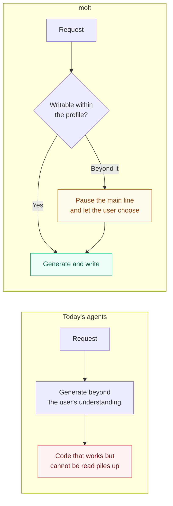
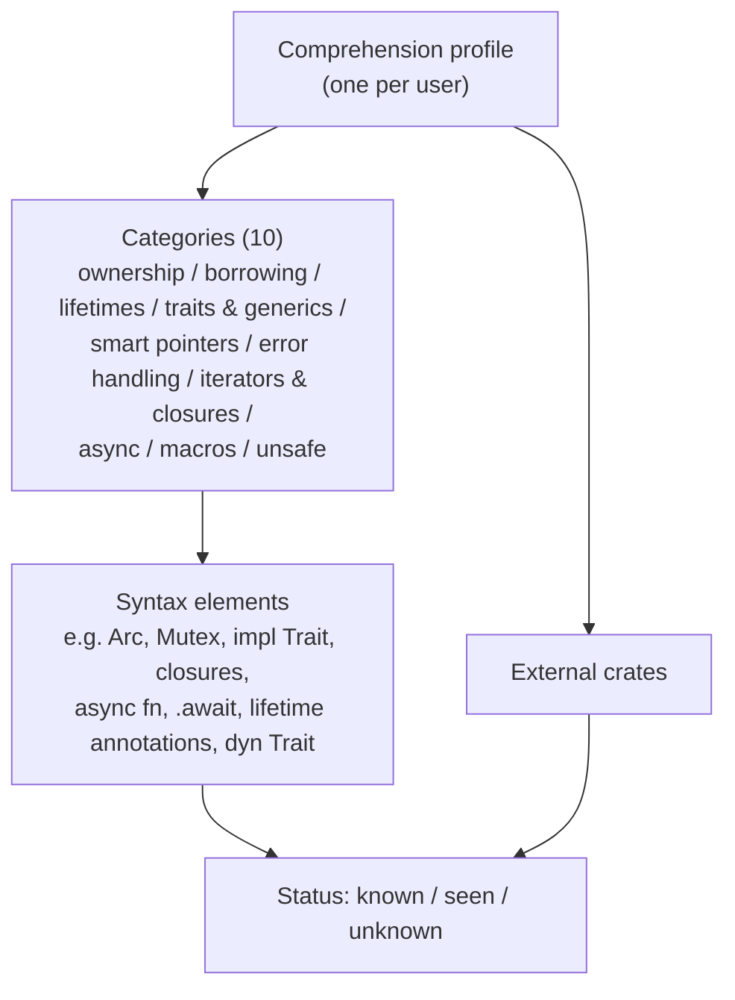
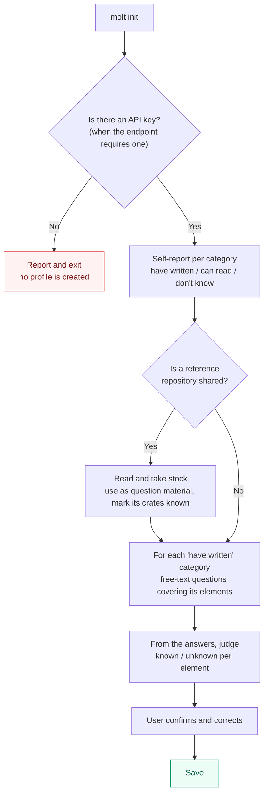
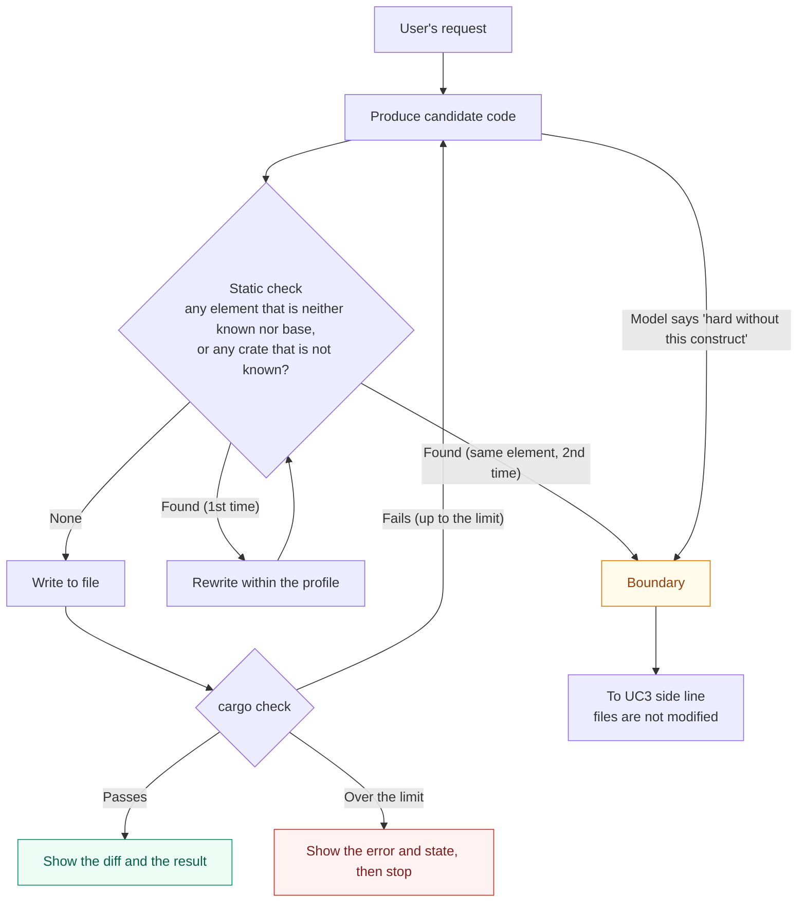
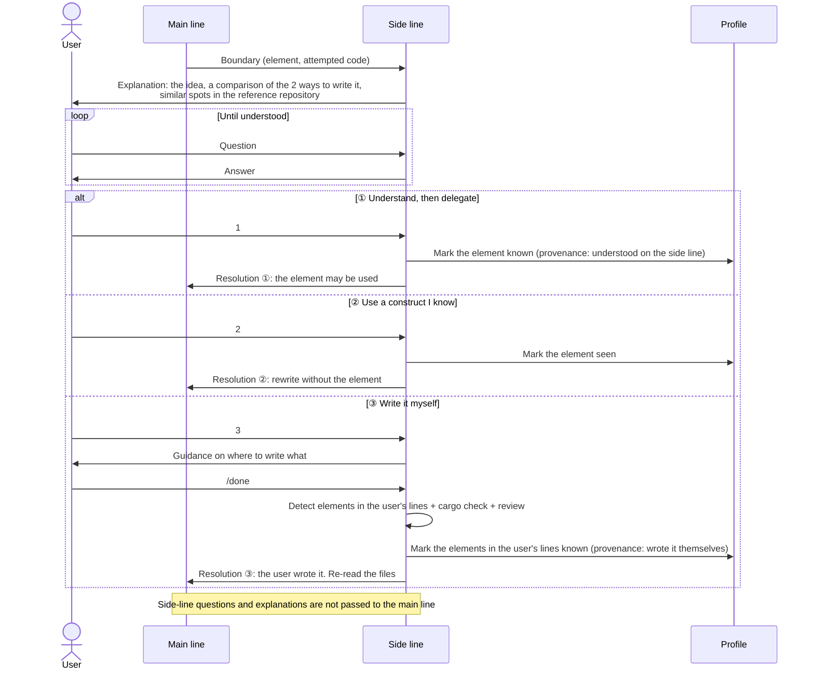
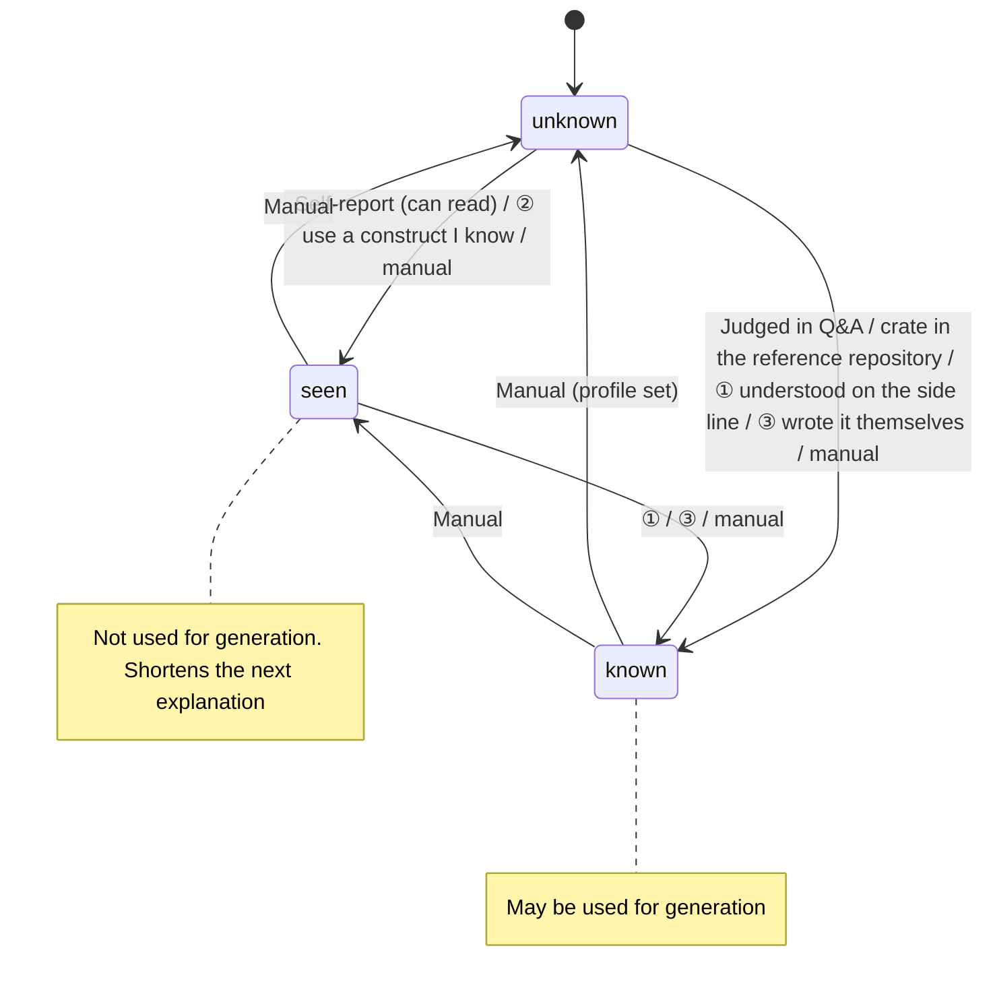
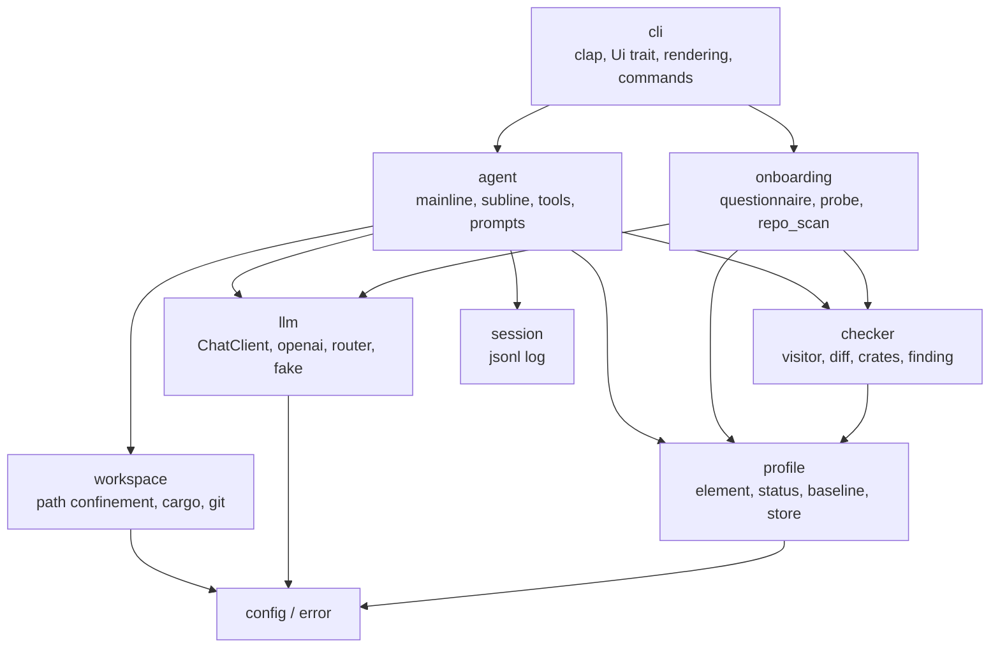
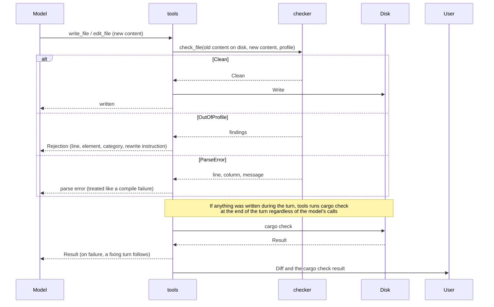
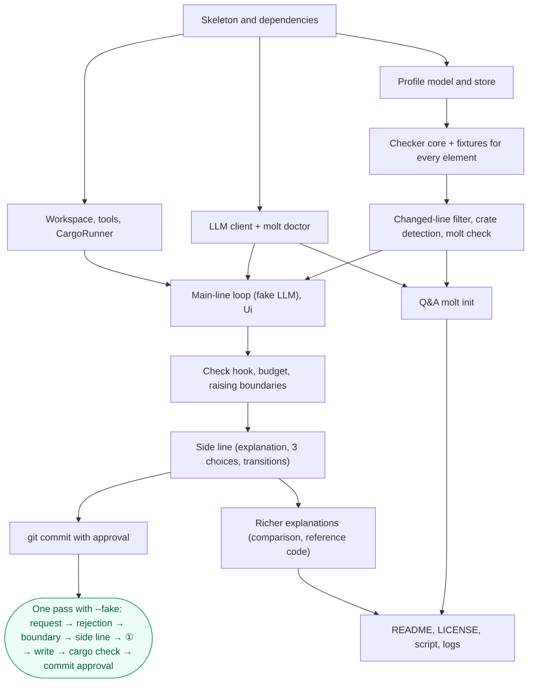

# PRD.md — molt requirements and design

[日本語版](PRD.ja.md)

The source of truth for the requirements and design of molt, a Rust coding agent that writes code only in the ways its user can understand.
It states why molt exists, what it guarantees, what the user wants to do, and how it is put together.
Progress and the current stage live in issues, how to start lives in the README, and the shape of each API, config, and profile lives in the code.
molt is an entry for a hackathon (Nebius x NVIDIA Global AI Hackathon), but the demo and the submission are out of scope here; first it has to stand as a product.

---

## 1. Purpose

AI can now produce code in bulk, yet engineers cannot understand what was generated, so they develop without gaining experience.
Today's coding agents use constructs the user has never written (for example `Arc<Mutex<T>>`) without a word, and the user ends up holding "code that works but cannot be read" in their own repository.

molt writes code only in the ways the user can write, and when a request goes beyond that range it pauses the main line and lets the user choose.
This removes "code I do not understand landing in my repository" without stopping development. Learning is a by-product; development is the main act. molt is not a teacher but a colleague who writes at the user's level of understanding.



What to read from the figure: the one point molt changes is "when the request goes beyond the user's understanding"; as long as it does not, molt behaves as an ordinary coding agent.

The design follows cognitive load theory. What it reduces is load unrelated to the essentials (constructs beyond the user's understanding, a huge diff at once); what it keeps is the load that builds understanding (deciding, writing by hand, asking).
The research it leans on is Anthropic's RCT (comprehension quiz average of 50% for the AI-assisted group versus 67% for the hand-written group; asking questions after generation to confirm scored 65% or higher). The study itself states that this is not a causal relationship, so molt claims nothing beyond "the patterns the study suggested were taken as design principles".

---

## 2. Terms



What to read from the figure: boundaries are judged per syntax element and per crate, while explanations are grouped per category.

| Term | Meaning |
|---|---|
| User | An engineer who develops their own Rust project with molt |
| Comprehension profile (profile) | The set of status and provenance per syntax element and per external crate. One per user |
| Category | One of the 10 groups that syntax elements are sorted into |
| Syntax element | The smallest unit of boundary judgement. The source of truth for the list is `Element` in the code and `tests/fixtures/elements/` |
| Base element | A syntax element that is always allowed (for example shared references `&`, `Result`, `Option`, `?`, and basic std macros such as `println!`). They cannot be avoided when writing Rust, so generation may use them regardless of the profile. The source of truth for the list is the default in the code |
| Status | `known` (can write it; generation may use it) / `seen` (can read it, or saw it on the side line; generation does not use it) / `unknown` (not known; any element with no entry is this) |
| Provenance | Why the status became what it is. Self-report / Q&A / reference repository / understood on the side line / wrote it themselves / manual |
| Boundary | The state where the code molt is about to write contains an element that is neither `known` nor a base element, and the request is hard to realise with the constructs in the profile |
| Main line | The dialogue that carries the user's development request forward |
| Side line | The dialogue opened at a boundary, with the main line paused, focused on that element. It never appears in the main line's transcript |

---

## 3. Guarantees

molt guarantees that no line it writes contains an element that is not `known`, that the user always chooses at a boundary, and that the side line never appears in the main line's transcript.

| Aspect | Guarantee |
|---|---|
| Core | No line molt writes contains a syntax element or external crate that is neither `known` nor a base element |
| Core | When an element that is not `known` is detected, the user can always choose from 3 options (understand then delegate / use a construct I know / write it myself). The main line does not advance until the user chooses or withdraws the request |
| Consistency | An element becomes `known` only through the user's answers (Q&A), a choice on the side line (① understood, ③ wrote it themselves), a crate used by the reference repository, or a manual operation. It never spreads by molt's judgement alone |
| Consistency | The check runs on the content before it is written, and content that fails the check never lands on disk |
| Consistency | A git commit contains only what the user approved. molt never commits or pushes without approval |
| Context separation | Questions and explanations exchanged on the side line never appear in the main line's transcript. What returns from the side line to the main line is the outcome of the choice (the kind of resolution and the element names) and, only for ②, a one-line coding policy |
| Observability | Detected elements, rejected generations, chosen options, and profile changes are kept in the session log and can be traced later |
| Verification | After molt writes, it runs `cargo check` and shows the user the result (the errors, if it fails) |
| Idempotence | However many times the same element appears within a session, it never becomes a boundary again once it is `known` |
| Language | Explanations, questions, and answers are returned in the language of the user's latest input. Fixed UI strings are English |
| Security | The API key is read from an environment variable and is never written to files, logs, or the session log. It is sent over plain `http://` (no TLS) only to a loopback host; for plain `http://` to any other host, the client is not created |

---

## 4. Non-guarantees

As the basis for judging over-building, the following are not handled.

| Not guaranteed | Reason / where it is handled |
|---|---|
| Comprehension quizzes or grading | Judging comprehension is left to self-report and dialogue in the Q&A |
| The "correctness" of generated code itself (whether it works as specified) | Only as far as `cargo check` (and `cargo test` when the user asks) can tell. Beyond that, the user reviews |
| Constraints on code the user writes themselves | What the user writes is not constrained. Rather, it enters the profile via path ③ |
| Checking code the user already had | Only the lines molt changed are checked. Elements that are not `known` in existing code do not stop molt |
| Approval for each write within the profile | If the check passes, molt writes. Approval is requested only for commits and for adding crates |
| A rush mode (lifting the constraints) | Out of scope. For future consideration |
| Generating the profile automatically from git history | When a reference repository is shared, it is used only as material for the Q&A and to read which crates it uses |
| Visualising the comprehension map, handling forgetting, splitting work into understandable units | Out of scope. For future consideration |
| Languages other than Rust | Out of scope |
| Web UI, hosting, demo URL, submission | Not considered now. Standing as a product comes first |
| Sharing a profile across multiple users or a team, running concurrently on the same profile or the same project | A profile belongs to one user. Running two molt instances at once is not assumed (last save wins) |

---

## 5. Fixed premises

| Kind | Premise |
|---|---|
| Technical | The LLM is called through an OpenAI-compatible chat API (`/v1/chat/completions`, Bearer auth when the endpoint requires it). The default, and the target for submission, is Nebius Token Factory. The API spec has function calling, `response_format` (json_object / json_schema), and `reasoning_effort`. Whether each endpoint and model actually accepts them is confirmed by `molt doctor` (8.7) |
| Technical | The default models, and the ones for submission, are NVIDIA Nemotron. The catalogue lists 4 of them, Lightning / Nano / Super / Ultra, all marked as supporting function calling. The default IDs are in 8.7. Any other model is only a verification target that has passed `doctor` (8.7) |
| Technical | The implementation is Rust (1.99.0, edition 2024). CI runs fmt / clippy (`-D warnings`) / test |
| Technical | The user's target project is a cargo project (`cargo check` runs) |
| Business | Deadline 2026-10-30 10:00 PDT (2026-10-31 02:00 JST). Target submission 10/29. Built by one person |
| Business | A public repository and an OSS licence (Apache 2.0 / MIT etc.) are submission requirements |

---

## 6. Use cases

### UC1 Create the comprehension profile (first-time setup)

The user self-reports per category, and only for the categories answered "have written" does molt ask free-text questions per syntax element to confirm.



What to read from the figure: questions are asked only for the categories reported as "have written", so the number of reports determines the time it takes.

- Precondition: no profile exists yet (or the user chose to recreate it). If the endpoint requires an API key, its environment variable (default `NEBIUS_API_KEY`) is set
- Main flow: report → (reference repository) → questions and judgement → confirmation → save. Reports map as follows: "have written" → the Q&A result (`known` / `unknown` per element), "can read" → the elements of that category become `seen`, "don't know" → `unknown`
- Main flow: external crates are not asked about in init. If a reference repository is shared, the dependencies in its `Cargo.toml` become `known` (provenance: reference repository). Any other crate becomes a boundary the first time molt tries to use it (UC3)
- Alternative flow: everything is "don't know" → skip the questions and save a profile with base elements only
- Alternative flow: a profile already exists → ask whether to overwrite; if declined, change nothing
- Exception flow: the shared path does not exist / is not a cargo project → report it and continue without a reference
- Exception flow: the API fails during the Q&A (auth, rate limit, network) → report the cause and exit; the partial profile is not saved
- Exception flow: interrupted midway → the partial profile is not saved
- Two `molt init` runs at the same time are not assumed (section 4; last save wins)
- Postcondition: status, provenance, and timestamp are saved per syntax element and per crate. Every `known` element originates from the user's answers or the reference repository

### UC2 Develop within the profile (main line)

Only generated code that passes the static check is written to files, and elements that cannot be avoided are handed to the side line as a boundary.



What to read from the figure: a compile failure is not a boundary. A boundary arises only when "an element that is not `known` cannot be avoided".

- Precondition: a profile exists. The current directory is a cargo project
- Main flow: request → candidate → check → write → `cargo check` → show the diff and the result. A write that passed the check needs no approval
- Alternative flow: the check finds an element that is not `known` → rewrite with constructs in the profile. If it passes, write
- Alternative flow: `cargo check` fails → fix using the errors and start again from the check. Past the limit (8.4), show the error and the last state, then stop
- Alternative flow: a `known` crate is not yet in `Cargo.toml` → ask the user whether to `cargo add` it, and add it only when approved. A crate that is not `known` is stopped by the check and becomes a boundary (UC3)
- Exception flow: the same element is rejected twice, or the model judges "hard without this construct" → go to UC3 as a boundary. Files are not modified
- Exception flow: tool calls in one turn exceed the limit (8.4) → show the state so far and stop
- Exception flow: not a cargo project → report it and stop
- Exception flow: the API fails (auth, rate limit, network) → report the cause; files are not changed
- Two molt instances on the same project are not assumed (section 4)
- Postcondition: no line molt wrote contains an element that is neither `known` nor a base element. The `cargo check` result has been shown to the user

### UC3 Choose at a boundary (side line)

The side line starts with an explanation, lets the user ask until they understand, and returns to the main line through a 3-way choice.



What to read from the figure: an element becomes `known` only through ① and ③ (② makes it `seen`). What returns to the main line is the kind of resolution and the element names, plus a one-line coding policy for ②.

- Precondition: UC2 reached a boundary. The main line is paused
- Main flow: explanation → questions (optional, unlimited) → choice → back to the main line
- Choice ①: the element becomes `known`, and the main line continues using it
- Choice ②: the element becomes `seen`, and the main line rewrites without it. If it cannot be rewritten, show why and stop
- Choice ③: molt does not write; it guides where to write what. The user writes and sends `/done` → molt reads the user's lines, runs `cargo check`, and returns a review. Every element in the user's lines that is not `known` becomes `known` (provenance: wrote it themselves). If the boundary is a crate, the crate the user added to `Cargo.toml` becomes `known`
- Alternative flow: `cargo check` fails in ③ → show the result; the user fixes it and sends `/done` again, or switches to ① or ②. The profile is not changed until `/done` passes
- Alternative flow: `/done` without writing anything in ③ → report that there is no change and let the user choose again
- Alternative flow: the request is withdrawn (`/abort`) → neither files nor the profile change; the main line waits for the next request
- Exception flow: interrupted on the side line (Ctrl-C, at its prompt or while waiting for the explanation, an answer, the policy of ②, or the guidance or review of ③) → change nothing (an interrupted question is not kept on the side line, an interrupted ② changes neither the profile nor the main line, and an interrupted ③ changes neither; after an interrupted review the user is still writing and sends `/done` again) and return the main line to the "paused at a boundary" state. The user chooses again or withdraws: `/side` goes back to the same side line (the explanation is not repeated once it has come, and is asked for again if it was interrupted; the questions go on), and `/abort` withdraws the request
- Exception flow: several elements become a boundary at once → the elements of one category (crates count as one category) are bundled into one side line, and its one choice holds for all of them. The other categories follow one at a time, a side line each, in the order their first element came. The main line does not advance, and the profile does not change, until every one has a choice; then each choice changes the profile in the order made, and their messages enter the main line together. An element the user's lines in ③ used needs no choice of its own (it becomes `known` by ③). `/abort` on any of the side lines withdraws the request, and the choices made before it change nothing (what the user wrote in ③ stays on the disk as they wrote it, and is not shown as part of the withdrawn request)
- Exception flow: after ②, the same boundary recurs in the same turn → stop at the second time, explain that the construct is needed, and recommend ① or ③
- Postcondition: the element is `known` after ①, and `seen` after ②. After ③, the elements in the user's lines are `known` (the element of the boundary only when the user's lines use it). No other element has changed. The main line's transcript has no side-line questions or explanations

### UC4 Commit the changes

A commit contains only what the user approved after seeing the diff and the proposed message.

- Precondition: molt has written (the files the user wrote in ③ count as written), and `cargo check` passes. The current directory is a git repository
- Main flow: the user asks (or molt proposes) → molt shows the diff of the files it changed (including `Cargo.toml` and `Cargo.lock` changed by `cargo add`) and a proposed message → approval → stage only that content and commit. The files molt changed also include the files the user wrote in ③ on the side line (UC3); their lines go into the diff and the commit as part of one change. A file changed in ③ that never passed `/done` (the user switched to ① or ② or withdrew the request) is not among them unless molt changed it too, and neither is one whose `/done` passed on a side line of a boundary whose request was then withdrawn on a later side line of it. The diff shown is what the commit records: each of those files against `HEAD` (a file git does not track yet, whole), so changes the user had made to such a file before molt changed it are in the diff and the commit too. molt proposes at the end of a turn that changed files, when the model is done, the user did not ask for a commit in that turn, and the last `cargo check` passes, in a git repository with something to commit; otherwise it proposes nothing and says nothing. The proposed message comes from the generate model, or is `molt: <the files>` when the model cannot give one; Ctrl-C while waiting for it drops the proposal
- Alternative flow: other changes, unstaged or staged, are mixed in → report them and confirm with the user whether to stage and commit only the files molt changed. The other changes stay as they are
- Exception flow: not approved → do nothing. The diff stays in the working tree
- Exception flow: nothing to commit → report it and do nothing
- Exception flow: the last `cargo check` is still failing → warn about that fact and confirm whether to commit anyway
- Exception flow: not a git repository → report it and do nothing
- Exception flow: `git commit` fails (a hook, `user.name` unset, etc.) → show the error and report that nothing was committed. The staging is left as is
- Postcondition: only the approved content is committed. Nothing is pushed

### UC5 View and edit the profile

The user can list the status and provenance per element and change a status by hand.

- Precondition: a profile exists
- Main flow (view): `molt profile show` lists the status, provenance, and timestamp of each element per category. Base elements are shown together at the end
- Main flow (edit): `molt profile set <element> <status>` changes the status. The provenance is "manual" and the change is recorded in the history. Setting a base element to `unknown` removes it from the base elements (`deny`). Setting it back to `known` removes it from `deny`
- Exception flow: a non-existent element name / an invalid status → reject and show the valid names and statuses. Change nothing
- Exception flow: no profile → prompt for `molt init`
- The change takes effect from the first generation of the next main line started (a running main line does not pick it up). An element that is no longer `known` becomes a boundary again
- Postcondition: the changed element's status and the provenance "manual" are saved, and the history has one more entry

---

## 7. Profile state transitions

An element has 3 statuses, and only `known` permits generation.



What to read from the figure: there is no path to `known` by molt's judgement alone. It always goes through the user's report, answer, or choice, or a repository the user shared.

---

## 8. Design

### 8.1 Key decisions

| Decision | Choice | Reason |
|---|---|---|
| Crate layout | A single crate, `lib` + a thin `bin` | The scale is small. Module boundaries and the `ChatClient` trait are enough for network-free tests |
| Parsing | syn 3 (`full` + `visit` + `extra-traits`), `proc-macro2` with `span-locations` | The check runs on the complete file before it is written. Anything syn cannot parse would not pass cargo either, so tree-sitter's strength in partial parsing brings nothing. No C toolchain needed |
| LLM client | Hand-written on reqwest + serde_json (behind the `ChatClient` trait) | Want control over Nemotron-specific response fields and over what is sent |
| git | Shell out to the `git` command (fixed argv) | Only the 4 operations status / diff / add / commit |
| Input | clap + rustyline (history, editing; approvals and choices are typed as lines too) | Raw stdin has no history and is hard to use. With a single input path, Ctrl-C while molt reads input is always rustyline's interruption, so at an approval or a choice it is no answer instead of ending molt; dialoguer's dialogs raise SIGINT on Ctrl-C. Ctrl-C while molt waits for the model drops that request and its response: on the main line the turn stops there and `molt> ` comes back (files written in the turn stay), and on the side line the main line goes back to being paused at the boundary (UC3). The SIGINT handler (signal-hook) acts only during that wait, so Ctrl-C at any other time (e.g. while cargo runs) ends molt as before. The connection is not cut, so the endpoint may go on generating, and an endpoint that generates one at a time may make the next request wait behind it |
| Where the check hooks in | The content received by `write_file` / `edit_file` is checked as a string before it is written to disk | Keeps "content that fails the check never lands on disk" by structure. The check becomes a pure function over strings |
| Scope of the check | Only the changed lines | So that code the user already had does not stop unrelated edits (section 4) |
| Separating the main and side lines | Separate message lists for the main line and the side line | Keeps "the side line never appears in the main line's transcript" by structure |
| Where the profile lives | `$MOLT_HOME` → `$XDG_CONFIG_HOME/molt` → `~/.config/molt` | Comprehension belongs to the user, so it lives in the user's config, not the repository |

### 8.2 Modules and dependencies



What to read from the figure: `checker` and `profile` do no I/O and can be unit-tested without a network. The LLM and cargo sit behind traits and are replaced with fakes in tests.

### 8.3 Data model

- `Category` (10) and `Element` (a closed enum). `Element::category()` is an exhaustive match. The source of truth for the element list is `Element` in the code and `tests/fixtures/elements/`
- `ItemKey = Element | Crate(String)` (toml keys are `arc` / `"crate:tokio"`)
- `Profile`: `{ status, provenance, at, evidence }` per element, the report per category, additions to and removals from the base elements (`allow` / `deny`), and the history (append-only)
- The default base elements live in the code. `clone()` is not among them (it is the core of the ownership category). The user can remove a base element with `deny`
- `CheckReport = Clean | OutOfProfile(Vec<Finding>) | ParseError`. ParseError is treated as a compile-type failure, not a boundary
- The inside of a macro invocation is invisible to syn. The arguments of the std macros that take Rust expressions (the `print!`, `format!` / `write!`, `vec!`, `assert!`, `dbg!`, `matches!` and `panic!` families; not `asm!`) are parsed as expressions and patterns and checked like the code around them, each finding on the line of its own token. Inline arguments of a format string (`{x}`) are not read, since they can only be names. Arguments that do not parse in the macro's shape are not seen, and the invocation is then also a `macro_call` finding. The inside of any other macro stays invisible → its invocation is itself a finding unless it is a base element or `known`
- New crates are detected from both the diff of dependency keys in `Cargo.toml` and the first segment of paths in the source (anything other than std / core / crate / self / super / the project's own modules)

### 8.4 The write path



What to read from the figure: only content judged Clean reaches the disk. Rejected content goes back to the model only, never to the user or the disk. `cargo check` is run by the agent even if the model does not call it, so "Verification" in section 3 does not depend on the model's behaviour.

Tools: `list_files` `read_file` `write_file` `edit_file` `run_cargo` `git_status` `git_diff` `git_commit` (approval required) `request_boundary(items, reason, proposed_code)` `finish`.
`write_file` / `edit_file` write only Rust source (`.rs`) and `Cargo.toml`, the files the check can read. Any other file is refused, since its content could reach the build unchecked (`#[path]`, `.cargo/config.toml`).
`run_cargo` accepts only `check` `test` `clippy` `build` `fmt` `add` (`add` requires approval; `run` and arbitrary subcommands are not accepted).
Budget per turn: 2 rejections of the same element, 3 compile fixes, 40 tool calls. A rejection counts toward the 2 from the next model response on, once the model has seen it; writes in one response are each a first rejection. A compile fix is asked for each content that does not parse and each failed `cargo check` at the end of the turn; the next failure after 3 stops the turn. At a boundary the turn is held for the user's choice, so `cargo check` waits too; when the user withdraws the request, molt runs it on what was written before the boundary and shows the diff and the result. Budget for the Q&A (UC1): 1 question per category, plus at most 1 follow-up question.

### 8.5 What the side line hands to the main line

Only one message enters the main line, in one of 3 forms. When a boundary had several side lines (UC3), it holds the form of each, in the order chosen; a bundled side line names all its elements in its form.

| Resolution | Message entering the main line | Profile |
|---|---|---|
| ① unlock | `BOUNDARY RESOLVED: unlock` + the permitted element names. The original approach may proceed | known (unlocked) |
| ② rewrite | `BOUNDARY RESOLVED: rewrite` + the still-forbidden element names + a one-line policy the light model made from the side-line transcript | seen |
| ③ user_wrote | `BOUNDARY RESOLVED: user_wrote` + the permitted element names. An instruction to re-read the files | known (wrote_themselves) |

### 8.6 CLI

```text
molt                      Open the main line in the cargo project at cwd (prompts for init if there is no profile)
molt init [--repo PATH]   Create the profile through Q&A. --repo takes stock of a reference repository
molt profile show|set <key> <status>|path
molt check [PATHS..]      Run the checker alone and print findings (exit 1 if any)
molt doctor               Check what the configured endpoint and models support
```

Common flags:

| Flag | What it replaces | Why |
|---|---|---|
| `--profile PATH` | Where the profile is read from and written to | Try a different profile without touching the one in the config directory |
| `--fake PATH` | The model's responses, with a script file and `FakeChatClient` | Run offline, without a model |
| `--ui-script PATH` | The user's inputs, choices, approvals, and interrupts, with a script file and `ScriptedUi`; output goes to stdout | Let a coding agent (not a person) drive one pass against a real model without a terminal |

The main-line prompt is `molt> `, the side-line prompt is `molt [sub: arc, mutex]> `. A ruled banner is printed on entering and leaving the side line, and side-line output is indented by 2 spaces. While the main line is paused at a boundary, it takes only `/side` and `/abort` (UC3); Ctrl-C or Ctrl-D there, and Ctrl-D on the side line, end molt as at the main-line prompt. The side line does not send a line starting with `/` that is not one of its commands to the model. If the explanation cannot be got, the side line says so and still takes questions.
On the side line, `/choose` lists the choices by number; Ctrl-C there is no choice, and the side line goes on. When a side line's items include one chosen ② for earlier in the same turn, the side line says the construct is needed and does not offer ② again. When other categories of the boundary still wait for a choice, molt says so after the choice and opens the side line of the next. Once every category has a choice, how each choice changed the profile is shown with the rest of the turn, after any approval the resumed turn asked for. If the profile cannot be saved after a choice, molt says so, and the choice still holds for the session. After ③, the side line shows where to write what and takes `/done` (not before ③); questions, `/choose` and `/abort` still work. `/done` takes the user's lines from the `.rs` files and `Cargo.toml`s that differ from when the side line opened. A file the user removed is not among them. If they do not parse, or `cargo check` fails or cannot run, it shows why and the side line goes on. If the guidance or the review cannot be got, the side line says so and ③ goes on. When `/done` passes, the `Cargo.lock` at the root joins the user's files if it differs from when the side line opened (`cargo check` updates it for a crate the user added); its diff is shown with the turn's changes, but the main line is not told to re-read it. Lines that use no item new to the profile still pass; nothing becomes `known`, and molt says so.
"Language" in section 3 is met by holding fixed UI strings in English and instructing the model to "answer in the language of the user's latest input" (there is no language-detection code).

### 8.7 Model roles and configuration

| Role | Default ID (confirmed in the catalogue) | Use |
|---|---|---|
| light | `nvidia/Nemotron-3_5-Lightning` | Judging the Q&A, the one-line side-line to main-line summary, log formatting |
| generate | `nvidia/nemotron-3-super-120b-a12b` | Code generation and rewriting, the review in ③ |
| reason | `nvidia/Nemotron-3-Ultra-550b-a55b` | Boundary judgement, alternatives within the profile, explanations, side-line Q&A, question generation |

`nvidia/NVIDIA-Nemotron-3-Nano-30B-A3B` is an alternative candidate for light. The source of truth for the defaults is the code that reads `config.toml`.
Configuration is `config.toml` (`[api]` `[models]` `[reasoning_effort]` `[capabilities]`). `[api]` points at the endpoint; whether it needs an API key differs per endpoint, and the key is read from an environment variable (section 3). For an endpoint that needs no key, set `api_key_env = ""`. When there is a key and `base_url` is `http://` to a host other than loopback (`localhost`, `127.0.0.0/8`, `::1`), the client is not created, so the key never leaves the machine in plain text. `[capabilities]` is written by `molt doctor`.
`molt doctor` checks, for the model of each role, that the ID exists, plain chat, a tool call with `tool_choice: required`, adherence to `response_format: json_schema`, and the behaviour of `reasoning_effort`, and prints a table. For a model that cannot use `json_schema`, it switches to `json_object` + the schema in the prompt + serde validation + 1 repair attempt.

Three things verify the agent against a model, and none replaces another.

| Layer | Endpoint | What it verifies | Where it runs |
|---|---|---|---|
| `--fake` | `FakeChatClient` with a script | The control flow and the guarantees in section 3, deterministically | CI and local tests |
| Local model | A local OpenAI-compatible endpoint, with any model that passes `doctor` | That the prompts actually elicit tool calls, rewrites, boundary judgements, and explanations, without spending credits | By hand or with `--ui-script`, and the `#[ignore]` tests, during development |
| Nemotron | Nebius Token Factory | That the configuration for submission passes `doctor` and the one pass in section 10 | By hand, before submission |

### 8.8 Persistence

The shape of the profile and the session log is defined by the code (`profile/store.rs`, `session.rs`). Only the reasons for the shape are written here.

| Decision | Reason |
|---|---|
| An element's status is overwritten, and each transition is appended to the history (`[[history]]`) | "When and why did it become `known`" can be traced later. It is also material for a future comprehension map |
| Provenance and timestamp are held per element | "It never spreads by molt's judgement alone" in section 3 can be verified from the saved content |
| Saving writes to a temporary file and then renames | A failure midway never leaves a corrupted profile |
| The session log is jsonl, one event per line. Side-line events (each choice that stands, and each profile change the choices made) carry `line: "sub"`, and so do the `MOLT_LOG` request bodies the side line sent | The main and side lines are distinguishable in the log, so "the side line never appears in the main line's transcript" in section 3 can be verified from the log |
| Request headers and the API key are not written to the session log. LLM request bodies go to a separate file only when `MOLT_LOG` is enabled (set to anything but empty or `0`) | "The API key is never written to logs" in section 3 |
| The session log lives in `sessions/` in the profile's place (8.1), one file per session | What it traces (detected elements, choices, profile changes) is about the user's comprehension, which belongs to the user like the profile. Kept out of the repository, it is not committed by mistake and does not show up in the files molt reads and writes |
| If the session log cannot be created, the main line does not open. If writing to it fails midway, molt tells the user once for each file and goes on without it | At start, the cause (molt's place cannot be written) is fixed before any request. Midway, stopping would leave the request half done |

---

## 9. Tests

The guarantees in section 3 are verified without a network.

| Target | Method |
|---|---|
| checker | Exact match between the leading `// expect: …` in `tests/fixtures/elements/*.rs` and the detected set. `fixtures/negative/*.rs` yields 0 findings other than base elements. A test enforces that every `Element` has a fixture. The changed-line filter (old↔new) does not report existing elements |
| profile | toml round trip, a transition grows the history, no entry = unknown, allow / deny, rejection of non-existent element names and invalid statuses |
| llm | `FakeChatClient` (a response queue + a record of sent requests). The wire format is compared with JSON fixtures. The real API is `#[ignore]` and runs against whatever endpoint `[api]` points at (8.7). The client refuses to be created with a key for plain `http://` to a non-loopback host, and is created for loopback, `https://`, or no key |
| agent (main line) | `FakeCargo` + tempdir. Clean → written to disk. Rejected → disk unchanged, and the rewrite passes. 2 rejections → boundary. `request_boundary` → boundary. Stops when the budget is exceeded |
| agent (side line) | ① → known, ② → seen, ③ → the elements in the user's lines are known. If `cargo check` fails in ③, the profile is unchanged. After ①, the same element is not a boundary again. The main line's request history has no side-line messages. `/abort` changes nothing. Elements of one category at a boundary share one side line, other categories get one each, and the main line does not advance until every one has a choice. After ① ② ③, the jsonl has the choice and the profile change with `line: "sub"`, and the main line's events do not |
| agent (git) | In a tempdir git repository: without approval → no new commit. With approval → only the files molt changed are committed, and push is not called |
| onboarding | With `ScriptedUi` + a fake judgement: the report "can read" → seen, "don't know" → unknown, "have written" → as judged. The dependencies in the reference repository's `Cargo.toml` are known. Provenance and timestamp are saved. Interrupted → not saved |
| session | One run from a rejection to a boundary leaves the detected elements, the rejected generation, the tool calls and the `cargo check` result in the jsonl. With a key given to the real client against a loopback endpoint that writes the key back, the key appears nowhere in the jsonl, the `MOLT_LOG` request bodies or stdout. Without `MOLT_LOG`, no file of request bodies is created |
| cli | `ScriptedUi` drives the side-line choice: ①, ② and ③ chosen at three boundaries in a row each put their 8.5 message into the main line. `assert_cmd` checks the exit code of `molt check` |

---

## 10. Implementation dependencies

The ordering constraints that follow from the dependencies between modules. The plan and progress live in issues.



What to read from the figure: the checker, the LLM client, and the Workspace do not depend on each other, so before the main-line loop they can be built in any order. The point where one pass runs from the main line through to a git commit is the measure of whether the product stands. The same pass is then tried against a real model, by hand or with `--ui-script` (8.7); that does not replace the `--fake` pass, which is what CI runs.

---

## 11. Risks and mitigations

| Risk | Mitigation |
|---|---|
| Nemotron's tool calls are unstable (broken argument JSON, returned as text) | Measure early with `doctor`. Parse arguments leniently and retry once. For an unknown tool, return the list of valid names as the error. The model can be swapped in the config |
| `json_schema` unsupported | Detect with `doctor` and apply the switch in 8.7 |
| `reasoning_effort` rejected | Confirm with `doctor` and send it only when `[capabilities]` is true |
| syn cannot parse the generated code | Return it as a compile-type failure with line and column. Not a boundary |
| The inside of a macro body is invisible | The arguments of the std macros that take Rust expressions are parsed and checked (8.3). Any other invocation is itself a finding unless it is a base element or `known`, and so is a std macro whose arguments do not parse. Documented as a limitation in the README |
| Elements spanning categories (`Box<dyn Error>` etc.) | Report one finding per element, and in the explanation group by category and remove duplicates. Unlocking is per element, so there is no contradiction |
| Approvals slow the pace of development | Approvals are only for commits and `cargo add` (section 4). Writes that passed the check and cargo check / test / clippy need no approval |
| Path escape and destructive operations | Confine to canonicalised paths under the root, and forbid writes to `.git/` and `target/`. `run_cargo` subcommands are only those enumerated. No shell strings; fixed argv |
| CI's `--locked` | Commit `Cargo.lock` on every `cargo add` (included in the scope of UC4) |
