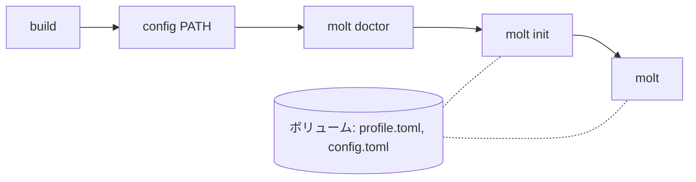

# molt

[English](README.md)

利用者が理解できる範囲の書き方でしかコードを書かない Rust コーディングエージェント。

molt は、利用者が理解している Rust の書き方をプロファイルに持つ。依頼に利用者がまだ書いたことのない書き方が要るとき、molt はその境界で止まり、副線で解説し、読めないコードを黙って書く代わりにどう進めるかを利用者に選ばせる。

## 前提

- [rustup](https://rustup.rs/)。toolchain の版は `rust-toolchain.toml` で固定していて、最初の `cargo` コマンドで rustup が入れる
- `~/.cargo/bin` が `PATH` にあること。入れた `molt` を実行するため

## インストール

```sh
git clone https://github.com/sumiredc/molt
cd molt
cargo install --locked --path .
```

## プロファイルを作る

molt は OpenAI 互換の chat API でモデルと話す。既定の接続先は Nebius Token Factory で、API キーを環境変数 `NEBIUS_API_KEY` から読む。別の接続先を使うときは、先に [設定](#設定) のとおりに設定する。

```sh
molt doctor
molt init
```

`molt doctor` は接続先とモデルが何に対応しているかを確かめ、`config.toml` に記録する（推奨。molt は `json_schema` と `reasoning_effort` を、対応すると確かめたモデルにだけ送る）。`molt init` は利用者が知っている Rust について尋ね、確認のあとプロファイルを保存する。`molt init --repo PATH` では、自分のリポジトリが使っている crate も読む。

## molt で開発する

cargo プロジェクトの直下（`Cargo.toml` のある場所）で `molt` を実行する:

```sh
molt
```

`molt> ` に依頼を書く。プロファイルの範囲の書き込みに承認は要らない。`cargo check` が通ると molt が commit メッセージを提案し、承認したときだけ commit する。`/quit` か Ctrl-D で molt が終わり、session log のパスを表示する。

## 境界で選ぶ

依頼にプロファイルがまだ許していない要素が要るとき、molt は止まり、解説とともに副線 `molt [sub: <要素>]> ` を開く。質問は何度でもでき、本線には入らない。そのあと `/choose` を打って 1 つ選ぶ:

| 選択 | 何が起きるか |
|---|---|
| ① 理解して任せる（`Understand, then delegate`） | 要素が `known` になり、molt は以後それを使う |
| ② 知っている書き方にする（`Use a construct I know`） | 要素が `seen` になり、molt はそれを使わずに書き直す |
| ③ 自分で書く（`Write it myself`） | molt がどこに何を書くかを示す。書いて `/done` を打つと、molt が `cargo check` を実行して利用者の行をレビューし、その行の要素が `known` になる |

`/abort` は依頼を取り下げ、それ以上何も変えない。molt がその依頼で書いたものは残り、`cargo check` の結果とともに表示される。副線で Ctrl-C を押したあとは、`/side` で副線に戻る。流れの全体は [PRD の UC3](PRD.ja.md#uc3-境界で選ぶ副線) にある。

## 制限

molt が保証しないことは [PRD §4](PRD.ja.md#4-保証しないこと) にある。たとえば、生成したコードは `cargo check` で分かる範囲までしか確かめず、利用者が元から持っていたコードは検査しない。molt はマクロ本体の中を見られない。Rust の式を取る std のマクロは引数を検査し、それ以外のマクロ呼び出しは、それ自体が基本要素か `known` でなければならない要素になる（[PRD §11](PRD.ja.md#11-リスクと手当て)）。

## 設定

設定は molt のディレクトリの `config.toml` に置く。[`examples/config.toml`](examples/config.toml) に、そのディレクトリの場所（`MOLT_HOME`、`XDG_CONFIG_HOME`）、全キーと既定値、ローカルの接続先に向ける方法がある。API キーは `api_key_env` に書いた名前の環境変数から読む。

molt は応答を 1 回につき `timeout_secs`（既定は 300）秒まで待つ。ローカルのモデルのように遅いモデルは、1 ファイルを書くのにそれより長くかかることがある。molt が `the chat API did not respond within 300 seconds` で止まったら、`[api]` の `timeout_secs` を延ばす。

`MOLT_LOG` を空でも `0` でもない値にすると、LLM へのリクエスト本文も書き出す。書き出し先は molt のディレクトリの `sessions/<time>-<pid>.requests.jsonl` で、session log の `sessions/<time>-<pid>.jsonl` の隣に置かれ、`molt` を `/quit` か Ctrl-D で終えると両方のパスを表示する（[PRD §8.8](PRD.ja.md#88-永続化)）。

## モデル無しで試す

`--fake PATH` はモデルを応答の台本に置き換えるので、1 周をオフラインで試せる。`molt` を入れたあと、このリポジトリの直下で:

```sh
MOLT_SRC=$(pwd)
cd "$(mktemp -d)"
cargo init --name sample
cp "$MOLT_SRC/examples/fake/profile.toml" ./profile.toml
molt --fake "$MOLT_SRC/examples/fake/one_pass.toml" --profile ./profile.toml
```

① を選ぶとプロファイルが書き換わるので、コピーを渡す。そのあと次のとおり入力する:

1. `molt> ` に依頼を書く。例: `Print 1 to stderr with dbg! in src/main.rs.`（台本は依頼の文を読まない）
2. 副線で `/choose`、続けて `1`
3. `Stage and commit only the files molt changed?` と `Commit with this message?` に `y`
4. `/quit`

molt は `dbg_macro` の境界で止まり、① のあと `src/main.rs` に `dbg!(1);` を書き、`Print 1 with dbg!` として commit する。

## コンテナで試す

`docker/sandbox.sh` は、Docker のイメージの中で molt をビルドし、終了すると消えるコンテナで実行する。試してもホストのこのリポジトリ・`~/.cargo/bin`・`~/.config/molt` は何も変わらない。毎回 `cargo init` したまっさらなサンプルから始まり、molt がそこで書いたものと commit はコンテナを抜けると消える。プロファイルと `config.toml` は、`reset` するまで名前付きボリューム（`MOLT_HOME`）に残る。要るのは Docker だけで、CI はイメージをビルドしない。



このリポジトリの直下で:

```sh
docker/sandbox.sh build
docker/sandbox.sh config path/to/config.toml
docker/sandbox.sh molt doctor
docker/sandbox.sh molt init
docker/sandbox.sh molt
```

| コマンド | 何をするか |
|---|---|
| `build` | イメージを作り、その中で molt をビルドする。molt を変えたら、もう一度実行する |
| `config PATH` | `config.toml` をボリュームに写す。写さなければ [設定](#設定) の既定値になる |
| `molt [ARGS…]` | サンプルの直下で `molt` を `ARGS` 付きで実行する |
| `shell` | サンプルの直下でシェルを開く。1 つのコンテナで何度も `molt` を実行するため |
| `reset` | ボリュームを消す。プロファイル・`config.toml`・session log が消える |

- `base_url` はコンテナの中から見たものになる。そこでの `localhost` はホストではなくコンテナを指す。ローカルの接続先は、ネットワーク上のアドレスで書く（`http://<local-endpoint>/v1`）。キーを要する `http://` の接続先は使えない。molt は `http://` ではループバックにしかキーを送らないため
- API キーは名前で渡し、イメージにもボリュームにも書かない。渡すのは `NEBIUS_API_KEY` と、別の `api_key_env` のために `MOLT_SANDBOX_ENV` に書いた名前（空白区切り）。`LC_ALL`・`LC_MESSAGES`・`LANG` も渡すので、`molt init` のフォームはホストと同じ言語になる
- [モデル無しで試す](#モデル無しで試す) の 1 周は、`shell` の中で `/opt/molt/examples/fake` の見本を使って試せる:

```sh
docker/sandbox.sh shell
cp /opt/molt/examples/fake/profile.toml ./profile.toml
molt --fake /opt/molt/examples/fake/one_pass.toml --profile ./profile.toml
```

## 次に読むもの

- 要件と設計：[PRD.ja.md](PRD.ja.md)

## ライセンス

[Apache License 2.0](LICENSE-APACHE) か [MIT License](LICENSE-MIT) のどちらかを選んで使える（`Apache-2.0 OR MIT`）。
