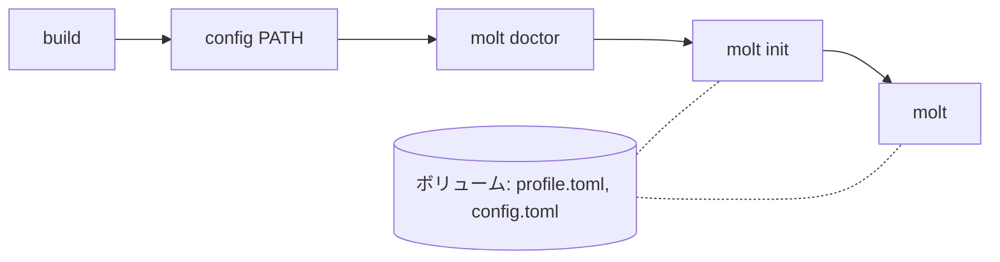

# molt

[English](README.md)

利用者が書いたことのある書き方はまとめて、まだ書いたことのない書き方は説明しながら 1 ステップずつ書く Rust コーディングエージェント。

molt は、利用者が書いたことのある Rust の書き方をプロファイルに持つ。それだけでできたコードは、そのまま書く。まだ書いたことのない書き方が要るときは、それを小さなステップとして書き、直後に止まって副線でその行を解説し、どう進めるかを利用者に選ばせる。読めないコードを黙って書くことも、覚えるべき書き方を避けて書くこともしない。

molt（モルト）という名前は、カニが大きくなるために殻を脱ぎ捨てること（脱皮＝molt）から取った。Rust のマスコットはカニで、molt では理解の範囲が殻にあたり、使うほど広がる。Grow your Rust, one shell at a time.

## 前提

- [rustup](https://rustup.rs/)。toolchain の版は `rust-toolchain.toml` で固定していて、最初の `cargo` コマンドで rustup が入れる
- `~/.cargo/bin` が `PATH` にあること。入れた `molt` を実行するため

## インストール

どちらの入れ方でも、[前提](#前提) の Rust の toolchain は要る。molt は利用者のプロジェクトで `cargo check` を実行するため。

[release](https://github.com/sumiredc/molt/releases) から入れる。ビルド済みのバイナリが macOS（Apple silicon）と Linux（x86_64、静的リンク）にある。OS に合うアーカイブを選び、`molt` を `PATH` に置いて、動くことを確かめる:

```sh
VERSION=v0.1.0
# macOS (Apple silicon)
curl -LO "https://github.com/sumiredc/molt/releases/download/$VERSION/molt-$VERSION-aarch64-apple-darwin.tar.gz"
tar -xzf "molt-$VERSION-aarch64-apple-darwin.tar.gz" molt
# Linux (x86_64)
curl -LO "https://github.com/sumiredc/molt/releases/download/$VERSION/molt-$VERSION-x86_64-unknown-linux-musl.tar.gz"
tar -xzf "molt-$VERSION-x86_64-unknown-linux-musl.tar.gz" molt

mv molt ~/.cargo/bin/
molt --version
```

- macOS: ブラウザで落としたアーカイブは quarantine の印が付き、Gatekeeper が `molt` の実行を止める。移す前に `xattr -d com.apple.quarantine molt` で印を外す（`curl` は印を付けない）
- Linux: バイナリにライブラリは要らないが、HTTPS には OS の証明書（`ca-certificates` パッケージ）が要る

またはソースから入れる。固定した toolchain で molt をビルドする:

```sh
git clone https://github.com/sumiredc/molt
cd molt
cargo install --locked --path .
```

## API キー

molt は OpenAI 互換の chat API でモデルと話す。既定の接続先は [Nebius Token Factory](https://tokenfactory.nebius.com/) で、API キーを環境変数 `NEBIUS_API_KEY` から読む。別の接続先を使うときは、先に [設定](#設定) のとおりに設定する。

1. Token Factory の [API keys](https://tokenfactory.nebius.com/project/api-keys) のページでキーを作る（docs の [Authentication](https://docs.tokenfactory.nebius.com/api-reference/introduction)）。キーは 1 回しか表示されないので、そこで写す
2. 下の行をシェルの設定ファイル（`~/.zshrc`、`~/.bashrc` など）に 1 回書き、新しいシェルを開く

```sh
export NEBIUS_API_KEY=…
```

この変数が無いと、モデルと話すコマンド（`molt doctor`、`molt init`、`molt`）はどれも `` the API key environment variable `NEBIUS_API_KEY` is not set `` と同じ案内を出して止まる。

## プロファイルを作る

```sh
molt doctor
molt init
```

`molt doctor` は接続先とモデルが何に対応しているかを確かめ、`config.toml` に記録する（推奨。molt は `json_schema` と `reasoning_effort` の送信と、応答のストリーミングを、対応すると確かめたモデルにだけ使う）。`molt init` は利用者が知っている Rust について尋ね、確認のあとプロファイルを保存する。`molt init --repo PATH` では、自分のリポジトリが使っている crate も読む。

## molt で開発する

cargo プロジェクトの直下（`Cargo.toml` のある場所）で `molt` を実行する:

```sh
molt
```

`molt> ` に依頼を書く。プロファイルで `known` のものだけの書き込みは、承認も要らず止まらない。それ以外を含む書き込みはステップになり、境界で止まる（下の節）。`cargo check` が通ると molt が commit メッセージを提案し、承認したときだけ commit する。`/quit` か Ctrl-D で molt が終わり、session log のパスを表示する。

## 境界で選ぶ

コードにプロファイルで `known` でない項目（構文要素か外部クレート）が要るとき、molt はそれを小さなステップとして書く。そうした項目は 3 つまで、変更する行は 30 行まで。ステップを書いた直後に止まり、副線 `molt [sub: <項目>]> ` を開いて、ステップの行を示して解説する。解説の下に選択肢が出るので、↑↓ と Enter か、番号のキーで 1 つ選ぶ。ほかの文字を打てば質問になり、何度でもでき、本線には入らない。答えのあとに選択肢がまた出る:

| 選択 | 何が起きるか |
|---|---|
| ① 理解した（`Understood`） | 項目が `known` になり、ステップは残り、molt は以後それを使う |
| ② 使わずに書く（`Write it without them`） | molt はステップを取り消し、項目が `seen` になり、その部分をそれを使わずに書き直す |
| ③ 自分で書く（`Write it myself`） | molt はステップを取り消し、どこに何を書くかを示す。書いて `/done` を打つと、molt が `cargo check` を実行して利用者の行をレビューし、その行の項目が `known` になる |
| ④ 次へ（`Next`） | ステップは残り、知らなかった項目は `seen` になる。次にそれを使うステップでも、短い解説とともに止まる |

`/abort` は依頼を取り下げる。molt はステップを取り消し、それより前に書いたものは残って、`cargo check` の結果とともに表示される。境界で止まったまま molt を終えたとき（Ctrl-D、止まっている本線での Ctrl-C）も、ステップを取り消す。副線で Ctrl-C を押したあとは、`/side` で副線に戻る。流れの全体は [PRD の UC3](PRD.ja.md#uc3-境界で選ぶ副線) にある。

## 制限

molt が保証しないことは [PRD §4](PRD.ja.md#4-保証しないこと) にある。たとえば、生成したコードは `cargo check` で分かる範囲までしか確かめず、利用者が元から持っていたコードは検査しない。molt はマクロ本体の中を見られない。Rust の式を取る std のマクロは引数を検査し、それ以外のマクロ呼び出しは、それ自体が `known` でなければならない要素になる（[PRD §11](PRD.ja.md#11-リスクと手当て)）。

## 設定

設定は molt のディレクトリの `config.toml` に置く。[`examples/config.toml`](examples/config.toml) に、そのディレクトリの場所（`MOLT_HOME`、`XDG_CONFIG_HOME`）、全キーと既定値、ローカルの接続先に向ける方法がある。API キーは `api_key_env` に書いた名前の環境変数から読む。

molt は応答を 1 回につき `timeout_secs`（既定は 300）秒まで待つ。`molt doctor` がストリーミングできると確かめたモデルでは、応答の何かが届くまでを待つ。ローカルのモデルのように遅いモデルは、1 ファイルを書くのにそれより長くかかることがある。先に `molt doctor` を走らせ、それでも molt が `the chat API did not respond within 300 seconds` で止まったら、`[api]` の `timeout_secs` を延ばす。

`MOLT_LOG` を空でも `0` でもない値にすると、LLM へのリクエスト本文も書き出す。書き出し先は molt のディレクトリの `sessions/<time>-<pid>.requests.jsonl` で、session log の `sessions/<time>-<pid>.jsonl` の隣に置かれ、`molt` を `/quit` か Ctrl-D で終えると両方のパスを表示する（[PRD §8.8](PRD.ja.md#88-永続化)）。

## Nebius Token Factory の Nemotron

molt はリクエストを 3 つの役割のどれかに送り、要る大きさのモデルに届ける。既定は Token Factory の NVIDIA Nemotron 3 のモデルで、[`src/config.rs`](src/config.rs) が正。`config.toml` の `[models]` と `[reasoning_effort]` で変えられる。

| 役割 | 既定のモデル | molt が送るもの | `reasoning_effort` |
|---|---|---|---|
| light | `nvidia/Nemotron-3_5-Lightning` | `molt init` の答えの判定（1 リクエスト 1 カテゴリ、3 並列）、② のあとに項目を使わずに書くための 1 行の方針 | `low` |
| generate | `nvidia/nemotron-3-super-120b-a12b` | コードを書くこと（`read_file`・`write_file`・`run_cargo` などのツールで。一覧は [`src/agent/mainline.rs`](src/agent/mainline.rs)）、② の書き直し、③ のレビュー、commit メッセージ | `medium` |
| reason | `nvidia/Nemotron-3-Ultra-550b-a55b` | ステップの解説、同じ部分をプロファイルの範囲で書いたもの、③ の案内（どこに何を書くか）、副線の質疑 | `high` |

2026-10-15 に `molt doctor` で、既定の 3 つが molt の頼るものをすべて受け付けると確かめた:

```text
role      model                              id  chat  tool_choice: required  json_schema  reasoning_effort  streaming
light     nvidia/Nemotron-3_5-Lightning      ok  ok    ok                     ok           ok (low)          ok
generate  nvidia/nemotron-3-super-120b-a12b  ok  ok    ok                     ok           ok (medium)       ok
reason    nvidia/Nemotron-3-Ultra-550b-a55b  ok  ok    ok                     ok           ok (high)         ok
```

| 列 | molt に何をもたらすか |
|---|---|
| `tool_choice: required` | `doctor` が、指定したツールで必ず返せることと、その引数が読めることを確かめる。本線はツールを `tool_choice: auto` で送り、コードはツール呼び出しで返る |
| `json_schema` | `molt init` の判定が molt の渡したスキーマの形で返り、散文を解析することがない。対応しないモデルには `json_object` とプロンプト内のスキーマで送り、修復を 1 回する |
| `reasoning_effort` | `doctor` がその役割で確かめたあとは、役割の値を毎回のリクエストに添える |
| `streaming` | 応答を流して受けるので、`timeout_secs` が区切るのは応答の中の間であって、reason モデルの解説の全体ではない |

既定の構成での 1 周を、`cargo init` したまっさらなプロジェクトで 2026-10-15 に 1 回だけ測った。5 カテゴリに答えた `molt init` が 19 秒。境界で止まった依頼（`numbers.iter().map(|&x| x * x).collect()`。まだ知らない要素が 3 つ）が、reason モデルの解説を経て ① で残り、`cargo check` が通って commit されるまでが 29 秒。

## モデル無しで試す

`--fake PATH` はモデルを応答の台本に置き換えるので、1 周をオフラインで試せる。`molt` を入れたあと、このリポジトリの直下で:

```sh
MOLT_SRC=$(pwd)
cd "$(mktemp -d)"
cargo init --name sample
cp "$MOLT_SRC/examples/fake/profile.toml" ./profile.toml
molt --fake "$MOLT_SRC/examples/fake/one_pass.toml" --profile ./profile.toml
```

① を選ぶとプロファイルが書き換わるので、コピーを渡す。そのあと次のとおり入力する:

1. `molt> ` に依頼を書く。例: `Print 1 to stderr with dbg! in src/main.rs.`（台本は依頼の文を読まない）
2. 副線の選択肢で `1`
3. `Stage and commit only the files molt changed?` と `Commit with this message?` に `y`
4. `/quit`

molt は `src/main.rs` に `dbg!(1);` をステップとして書き、`dbg_macro` の境界で止まって解説し、① のあとステップを残して、`Print 1 with dbg!` として commit する。

## コンテナで試す

`docker/sandbox.sh` は、Docker のイメージの中で molt をビルドし、終了すると消えるコンテナで実行する。試してもホストのこのリポジトリ・`~/.cargo/bin`・`~/.config/molt` は何も変わらない。毎回 `cargo init` したまっさらなサンプルから始まり、molt がそこで書いたものと commit はコンテナを抜けると消える。プロファイルと `config.toml` は、`reset` するまで名前付きボリューム（`MOLT_HOME`）に残る。要るのは Docker だけで、CI はイメージをビルドしない。



このリポジトリの直下で:

```sh
docker/sandbox.sh build
docker/sandbox.sh config path/to/config.toml
docker/sandbox.sh molt doctor
docker/sandbox.sh molt init
docker/sandbox.sh molt
```

| コマンド | 何をするか |
|---|---|
| `build` | イメージを作り、その中で molt をビルドする。molt を変えたら、もう一度実行する |
| `config PATH` | `config.toml` をボリュームに写す。写さなければ [設定](#設定) の既定値になる |
| `molt [ARGS…]` | サンプルの直下で `molt` を `ARGS` 付きで実行する |
| `shell` | サンプルの直下でシェルを開く。1 つのコンテナで何度も `molt` を実行するため |
| `reset` | ボリュームを消す。プロファイル・`config.toml`・session log が消える |

- `base_url` はコンテナの中から見たものになる。そこでの `localhost` はホストではなくコンテナを指す。ローカルの接続先は、ネットワーク上のアドレスで書く（`http://<local-endpoint>/v1`）。キーを要する `http://` の接続先は使えない。molt は `http://` ではループバックにしかキーを送らないため
- API キーは名前で渡し、イメージにもボリュームにも書かない。渡すのは `NEBIUS_API_KEY` と、別の `api_key_env` のために `MOLT_SANDBOX_ENV` に書いた名前（空白区切り）。`LC_ALL`・`LC_MESSAGES`・`LANG` も渡すので、`molt init` のフォームはホストと同じ言語になる
- [モデル無しで試す](#モデル無しで試す) の 1 周は、`shell` の中で `/opt/molt/examples/fake` の見本を使って試せる:

```sh
docker/sandbox.sh shell
cp /opt/molt/examples/fake/profile.toml ./profile.toml
molt --fake /opt/molt/examples/fake/one_pass.toml --profile ./profile.toml
```

## 次に読むもの

- 要件と設計：[PRD.ja.md](PRD.ja.md)

## ライセンス

[Apache License 2.0](LICENSE-APACHE) か [MIT License](LICENSE-MIT) のどちらかを選んで使える（`Apache-2.0 OR MIT`）。
