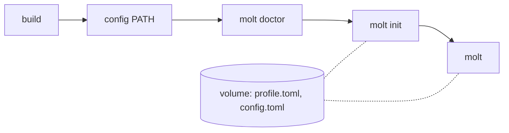

# molt

[日本語版](README.ja.md)

A Rust coding agent that writes what its user already knows in bulk, and what they have not written yet one explained step at a time.

molt keeps a profile of the Rust constructs you have written. Code made of them, molt writes as it comes. When the code needs a construct you have never written, molt writes it in a small step, stops right after it, explains those lines on a side line, and lets you choose how to go on, instead of writing code you cannot read or writing around what you have yet to learn.

## Prerequisites

- [rustup](https://rustup.rs/). The toolchain version is pinned in `rust-toolchain.toml`, and rustup installs it on the first `cargo` command
- `~/.cargo/bin` on your `PATH`, so that the installed `molt` runs

## Install

Either way, the Rust toolchain of [Prerequisites](#prerequisites) is needed: molt runs `cargo check` in your project.

From a [release](https://github.com/sumiredc/molt/releases), with a built binary for macOS (Apple silicon) and Linux (x86_64, statically linked). Pick the archive for your OS, put `molt` on your `PATH`, and check that it runs:

```sh
VERSION=v0.1.0
# macOS (Apple silicon)
curl -LO "https://github.com/sumiredc/molt/releases/download/$VERSION/molt-$VERSION-aarch64-apple-darwin.tar.gz"
tar -xzf "molt-$VERSION-aarch64-apple-darwin.tar.gz" molt
# Linux (x86_64)
curl -LO "https://github.com/sumiredc/molt/releases/download/$VERSION/molt-$VERSION-x86_64-unknown-linux-musl.tar.gz"
tar -xzf "molt-$VERSION-x86_64-unknown-linux-musl.tar.gz" molt

mv molt ~/.cargo/bin/
molt --version
```

- macOS: an archive downloaded with a browser is quarantined, and Gatekeeper stops `molt` from running. Remove the mark with `xattr -d com.apple.quarantine molt` before moving it (`curl` does not set it)
- Linux: the binary needs no libraries, but HTTPS needs the OS certificates (the `ca-certificates` package)

Or from the source, which builds molt with the pinned toolchain:

```sh
git clone https://github.com/sumiredc/molt
cd molt
cargo install --locked --path .
```

## API key

molt talks to a model through an OpenAI-compatible chat API. By default it uses [Nebius Token Factory](https://tokenfactory.nebius.com/) and reads the API key from the environment variable `NEBIUS_API_KEY`; to use another endpoint, set it up first as in [Configuration](#configuration).

1. Create a key on the [API keys](https://tokenfactory.nebius.com/project/api-keys) page of Token Factory ([Authentication](https://docs.tokenfactory.nebius.com/api-reference/introduction) in its docs). The key is shown once, so copy it there
2. Add the line below to your shell's startup file (`~/.zshrc`, `~/.bashrc`, ...) once, and open a new shell

```sh
export NEBIUS_API_KEY=…
```

Without the variable, every command that talks to the model (`molt doctor`, `molt init`, `molt`) stops with `` the API key environment variable `NEBIUS_API_KEY` is not set `` and the same instruction.

## Create your profile

```sh
molt doctor
molt init
```

`molt doctor` checks what the endpoint and models support and records it in `config.toml` (recommended: molt sends `json_schema` and `reasoning_effort`, and streams responses, only for the models it has found to support them). `molt init` asks about the Rust you know and saves your profile after you confirm it. `molt init --repo PATH` also reads which crates a repository of yours uses.

## Develop with molt

Run `molt` in the root of a cargo project (where `Cargo.toml` is):

```sh
molt
```

Type a request at `molt> `. Writes of what your profile has as `known` need no approval and do not stop; a write with anything else is a step, which stops at a boundary (below). After `cargo check` passes, molt proposes a commit message and commits only when you approve. `/quit` or Ctrl-D ends molt and prints the path of the session log.

## Choosing at a boundary

When code needs an item (a syntax element or a crate) your profile does not have as `known`, molt writes it as a small step: at most 3 such items and 30 changed lines. Right after the step it stops and opens a side line `molt [sub: <items>]> `, which shows the step's lines and explains them. The choices are listed under the explanation: choose one with ↑↓ and Enter, or press its number. Typing anything else asks a question instead; ask as many as you like, they never enter the main line, and the choices come back after each answer:

| Choice | What happens |
|---|---|
| ① Understood | The items become `known`, the step stays, and molt uses them from now on |
| ② Write it without them | molt takes the step back, the items become `seen`, and molt writes that part without them |
| ③ Write it myself | molt takes the step back and shows where to write what. Write it and type `/done`; molt runs `cargo check` and reviews your lines, and the items in them become `known` |
| ④ Next | The step stays, and items you did not know become `seen`. The next step that uses them stops again, with a shorter explanation |

`/abort` withdraws the request: molt takes the step back, and what it wrote before the step stays and is shown with `cargo check`. Ending molt at a boundary (Ctrl-D, or Ctrl-C while paused) takes the step back too. After Ctrl-C on the side line, `/side` goes back to it. The full flow is in [PRD UC3](PRD.md#uc3-choose-at-a-boundary-side-line).

## Limitations

What molt does not guarantee is listed in [PRD §4](PRD.md#4-non-guarantees); for example, the generated code is checked only as far as `cargo check`, and code you already had is not checked. molt cannot see inside a macro body: it checks the arguments of the std macros that take Rust expressions, and any other macro call is itself an item that must be `known` ([PRD §11](PRD.md#11-risks-and-mitigations)).

## Configuration

Settings live in `config.toml` in molt's directory; [`examples/config.toml`](examples/config.toml) shows where that directory is (`MOLT_HOME`, `XDG_CONFIG_HOME`), every key with its default, and how to point at a local endpoint. The API key is read from the environment variable named by `api_key_env`.

molt waits `timeout_secs` (300 by default) for each response, or, for a model `molt doctor` found it can stream, for anything of the response to arrive. A slow model, such as a local one, can take longer than that to write one file: run `molt doctor` first, and when molt still stops with `the chat API did not respond within 300 seconds`, raise `timeout_secs` under `[api]`.

Set `MOLT_LOG` to anything but empty or `0` to also write the LLM request bodies: they go to `sessions/<time>-<pid>.requests.jsonl` in molt's directory, next to the session log `sessions/<time>-<pid>.jsonl`, and `molt` prints both paths when it ends with `/quit` or Ctrl-D ([PRD §8.8](PRD.md#88-persistence)).

## Nemotron on Nebius Token Factory

molt sends each request to one of three roles, so that a request goes to a model of the size it needs. The defaults are the NVIDIA Nemotron 3 models on Token Factory; [`src/config.rs`](src/config.rs) holds them, and `[models]` and `[reasoning_effort]` in `config.toml` change them.

| Role | Default model | What molt sends it | `reasoning_effort` |
|---|---|---|---|
| light | `nvidia/Nemotron-3_5-Lightning` | The judgement of the answers of `molt init` (one category per request, 3 at a time), the one-line policy after ② for writing without the items | `low` |
| generate | `nvidia/nemotron-3-super-120b-a12b` | Writing the code, through tools such as `read_file`, `write_file` and `run_cargo` (the list is in [`src/agent/mainline.rs`](src/agent/mainline.rs)), the rewrite of ②, the review of ③, the commit message | `medium` |
| reason | `nvidia/Nemotron-3-Ultra-550b-a55b` | The explanation of a step, the same part within your profile, the guidance of ③ (where to write what), and the side-line Q&A | `high` |

`molt doctor` confirmed, on 2026-10-15, that each default accepts everything molt relies on:

```text
role      model                              id  chat  tool_choice: required  json_schema  reasoning_effort  streaming
light     nvidia/Nemotron-3_5-Lightning      ok  ok    ok                     ok           ok (low)          ok
generate  nvidia/nemotron-3-super-120b-a12b  ok  ok    ok                     ok           ok (medium)       ok
reason    nvidia/Nemotron-3-Ultra-550b-a55b  ok  ok    ok                     ok           ok (high)         ok
```

| Column | What it gives molt |
|---|---|
| `tool_choice: required` | `doctor` checks that the model answers with the named tool when told to, and that its arguments parse. The main line sends its tools with `tool_choice: auto`, and the code comes back as tool calls |
| `json_schema` | The judgement of `molt init` comes back in the schema molt gives, never as prose to parse. A model without it gets `json_object`, the schema in the prompt, and one repair |
| `reasoning_effort` | Once `doctor` has confirmed it for a role, the value of the role goes with every request |
| `streaming` | The reply is streamed, so `timeout_secs` bounds a pause in it, not the whole explanation of the reason model |

One pass on these defaults, in a fresh `cargo init` project, measured once on 2026-10-15: `molt init` with 5 categories answered took 19 s, and a request that stopped at a boundary (`numbers.iter().map(|&x| x * x).collect()`, three items not yet known), was explained by the reason model, kept with ①, passed `cargo check` and was committed took 29 s.

## Try it without a model

`--fake PATH` replaces the model with a script of responses, so you can try one pass offline. From the root of this repository, with `molt` installed:

```sh
MOLT_SRC=$(pwd)
cd "$(mktemp -d)"
cargo init --name sample
cp "$MOLT_SRC/examples/fake/profile.toml" ./profile.toml
molt --fake "$MOLT_SRC/examples/fake/one_pass.toml" --profile ./profile.toml
```

Pass a copy of the profile, because choosing ① rewrites it. Then type:

1. A request at `molt> `, such as `Print 1 to stderr with dbg! in src/main.rs.` (the script does not read it)
2. `1` at the side line's choices
3. `y` to `Stage and commit only the files molt changed?` and to `Commit with this message?`
4. `/quit`

molt writes `dbg!(1);` into `src/main.rs` as a step, stops at the boundary for `dbg_macro` and explains it, keeps the step after ①, and commits it as `Print 1 with dbg!`.

## Try it in a container

`docker/sandbox.sh` builds molt inside a Docker image and runs it in a container that is removed on exit, so trying molt changes nothing on the host: not this repository, not `~/.cargo/bin`, not `~/.config/molt`. Each run starts in a fresh sample project made with `cargo init`; what molt writes and commits there is gone when the container exits. The profile and `config.toml` stay on a named volume (`MOLT_HOME`) until `reset`. It needs only Docker; the CI does not build the image.



From the root of this repository:

```sh
docker/sandbox.sh build
docker/sandbox.sh config path/to/config.toml
docker/sandbox.sh molt doctor
docker/sandbox.sh molt init
docker/sandbox.sh molt
```

| Command | What it does |
|---|---|
| `build` | Builds the image, with molt built inside it. Run it again after changing molt |
| `config PATH` | Copies a `config.toml` into the volume. Without one, the defaults of [Configuration](#configuration) apply |
| `molt [ARGS…]` | Runs `molt` with `ARGS` in the sample project |
| `shell` | Opens a shell in the sample project, to run `molt` several times in one container |
| `reset` | Removes the volume: the profile, `config.toml`, and the session logs |

- `base_url` is seen from inside the container: `localhost` there is the container, not the host. With a local endpoint, write its address on your network (`http://<local-endpoint>/v1`). An `http://` endpoint that needs a key does not work, because molt sends a key over `http://` only to loopback
- The API key is passed by name, never written to the image or the volume: `NEBIUS_API_KEY`, and the names in `MOLT_SANDBOX_ENV` (space-separated) for another `api_key_env`. `LC_ALL`, `LC_MESSAGES` and `LANG` are passed too, so the form of `molt init` is in the host's language
- The one pass of [Try it without a model](#try-it-without-a-model) works in `shell`, with the examples at `/opt/molt/examples/fake`:

```sh
docker/sandbox.sh shell
cp /opt/molt/examples/fake/profile.toml ./profile.toml
molt --fake /opt/molt/examples/fake/one_pass.toml --profile ./profile.toml
```

## Next reading

- Requirements and design: [PRD.md](PRD.md)

## License

Licensed under [Apache License 2.0](LICENSE-APACHE) or [MIT License](LICENSE-MIT) at your option (`Apache-2.0 OR MIT`).
