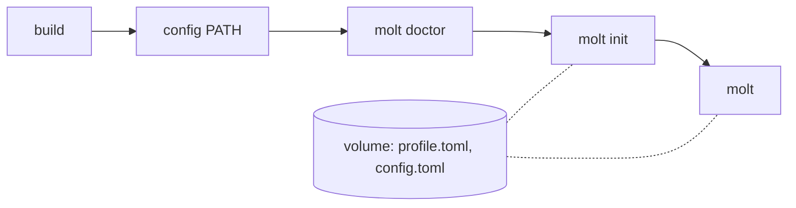

# molt

[日本語版](README.ja.md)

A Rust coding agent that writes code only in the ways its user can understand.

molt keeps a profile of the Rust constructs you understand. When a request needs a construct you have never written, molt stops at that boundary, explains it on a side line, and lets you choose how to go on instead of silently writing code you cannot read.

## Prerequisites

- [rustup](https://rustup.rs/). The toolchain version is pinned in `rust-toolchain.toml`, and rustup installs it on the first `cargo` command
- `~/.cargo/bin` on your `PATH`, so that the installed `molt` runs

## Install

```sh
git clone https://github.com/sumiredc/molt
cd molt
cargo install --locked --path .
```

## Create your profile

molt talks to a model through an OpenAI-compatible chat API. By default it uses Nebius Token Factory and reads the API key from the environment variable `NEBIUS_API_KEY`; to use another endpoint, set it up first as in [Configuration](#configuration).

```sh
molt doctor
molt init
```

`molt doctor` checks what the endpoint and models support and records it in `config.toml` (recommended: molt sends `json_schema` and `reasoning_effort` only to the models it has found to support them). `molt init` asks about the Rust you know and saves your profile after you confirm it. `molt init --repo PATH` also reads which crates a repository of yours uses.

## Develop with molt

Run `molt` in the root of a cargo project (where `Cargo.toml` is):

```sh
molt
```

Type a request at `molt> `. Writes within your profile need no approval; after `cargo check` passes, molt proposes a commit message and commits only when you approve. `/quit` or Ctrl-D ends molt and prints the path of the session log.

## Choosing at a boundary

When a request needs an item your profile does not allow yet, molt stops and opens a side line `molt [sub: <items>]> ` with an explanation. Ask as many questions as you like; they never enter the main line. Then type `/choose` and pick one:

| Choice | What happens |
|---|---|
| ① Understand, then delegate | The item becomes `known`, and molt uses it from now on |
| ② Use a construct I know | The item becomes `seen`, and molt rewrites without it |
| ③ Write it myself | molt shows where to write what. Write it and type `/done`; molt runs `cargo check` and reviews your lines, and the items in them become `known` |

`/abort` withdraws the request and changes nothing more; what molt already wrote for it stays and is shown with `cargo check`. After Ctrl-C on the side line, `/side` goes back to it. The full flow is in [PRD UC3](PRD.md#uc3-choose-at-a-boundary-side-line).

## Limitations

What molt does not guarantee is listed in [PRD §4](PRD.md#4-non-guarantees); for example, the generated code is checked only as far as `cargo check`, and code you already had is not checked. molt cannot see inside a macro body: it checks the arguments of the std macros that take Rust expressions, and any other macro call is itself an item that must be `known` ([PRD §11](PRD.md#11-risks-and-mitigations)).

## Configuration

Settings live in `config.toml` in molt's directory; [`examples/config.toml`](examples/config.toml) shows where that directory is (`MOLT_HOME`, `XDG_CONFIG_HOME`), every key with its default, and how to point at a local endpoint. The API key is read from the environment variable named by `api_key_env`.

molt waits `timeout_secs` (300 by default) for each response. A slow model, such as a local one, can take longer than that to write one file: when molt stops with `the chat API did not respond within 300 seconds`, raise `timeout_secs` under `[api]`.

Set `MOLT_LOG` to anything but empty or `0` to also write the LLM request bodies: they go to `sessions/<time>-<pid>.requests.jsonl` in molt's directory, next to the session log `sessions/<time>-<pid>.jsonl`, and `molt` prints both paths when it ends with `/quit` or Ctrl-D ([PRD §8.8](PRD.md#88-persistence)).

## Try it without a model

`--fake PATH` replaces the model with a script of responses, so you can try one pass offline. From the root of this repository, with `molt` installed:

```sh
MOLT_SRC=$(pwd)
cd "$(mktemp -d)"
cargo init --name sample
cp "$MOLT_SRC/examples/fake/profile.toml" ./profile.toml
molt --fake "$MOLT_SRC/examples/fake/one_pass.toml" --profile ./profile.toml
```

Pass a copy of the profile, because choosing ① rewrites it. Then type:

1. A request at `molt> `, such as `Print 1 to stderr with dbg! in src/main.rs.` (the script does not read it)
2. `/choose` on the side line, then `1`
3. `y` to `Stage and commit only the files molt changed?` and to `Commit with this message?`
4. `/quit`

molt stops at the boundary for `dbg_macro`, writes `dbg!(1);` into `src/main.rs` after ①, and commits it as `Print 1 with dbg!`.

## Try it in a container

`docker/sandbox.sh` builds molt inside a Docker image and runs it in a container that is removed on exit, so trying molt changes nothing on the host: not this repository, not `~/.cargo/bin`, not `~/.config/molt`. Each run starts in a fresh sample project made with `cargo init`; what molt writes and commits there is gone when the container exits. The profile and `config.toml` stay on a named volume (`MOLT_HOME`) until `reset`. It needs only Docker; the CI does not build the image.



From the root of this repository:

```sh
docker/sandbox.sh build
docker/sandbox.sh config path/to/config.toml
docker/sandbox.sh molt doctor
docker/sandbox.sh molt init
docker/sandbox.sh molt
```

| Command | What it does |
|---|---|
| `build` | Builds the image, with molt built inside it. Run it again after changing molt |
| `config PATH` | Copies a `config.toml` into the volume. Without one, the defaults of [Configuration](#configuration) apply |
| `molt [ARGS…]` | Runs `molt` with `ARGS` in the sample project |
| `shell` | Opens a shell in the sample project, to run `molt` several times in one container |
| `reset` | Removes the volume: the profile, `config.toml`, and the session logs |

- `base_url` is seen from inside the container: `localhost` there is the container, not the host. With a local endpoint, write its address on your network (`http://<local-endpoint>/v1`). An `http://` endpoint that needs a key does not work, because molt sends a key over `http://` only to loopback
- The API key is passed by name, never written to the image or the volume: `NEBIUS_API_KEY`, and the names in `MOLT_SANDBOX_ENV` (space-separated) for another `api_key_env`. `LC_ALL`, `LC_MESSAGES` and `LANG` are passed too, so the form of `molt init` is in the host's language
- The one pass of [Try it without a model](#try-it-without-a-model) works in `shell`, with the examples at `/opt/molt/examples/fake`:

```sh
docker/sandbox.sh shell
cp /opt/molt/examples/fake/profile.toml ./profile.toml
molt --fake /opt/molt/examples/fake/one_pass.toml --profile ./profile.toml
```

## Next reading

- Requirements and design: [PRD.md](PRD.md)

## License

Licensed under [Apache License 2.0](LICENSE-APACHE) or [MIT License](LICENSE-MIT) at your option (`Apache-2.0 OR MIT`).
